# PES 2021 foundation merge: structure inventory, gates, dependency graph, build order

Status: merged inventory (orchestrator-reviewed 15-10-26). Gate ports are paused until the waves below are scheduled. Sources live in the RE evidence archive.

Inputs (RE evidence archive): `pes-re-foundation-teamplayer.md` (TP), `pes-re-foundation-matchball.md` (MB), `pes-re-foundation-widen.md` (W), `pes-re-foundation-areas.md` (AR). Authoritative corrections: `pes-re-foundation-verify.md` (V). Context: `pes-re-PoseVeto.md`, `pes-re-Dribble-inventory.md`, `pes-re-NetDodge.md`, `pes-re-OffBallSelectors-inventory.md`, `pes-re-livepoke.md`, `pes-re-live-matchball.md`. Repo: `docs/re/README.md`, `docs/re/pes-ai-map.md`, `tasks/14-10-26.md`.

Reconciliation with `godotfootball-foundation-plan.md` (Oct 12): that plan is a repo-bootstrap plan (Steps 0 to 7: toolchain, PES VFS, rig, textures, animation, copying the GF simulation into `src/sim`). Its "foundation" is the engine foundation, not PES runtime state. It contains no runtime-state inventory or gate list, so none of its statements are carried over. `src/sim` exists at HEAD. Section 4 supersedes the plan for AI-state port order.

Repo and live state at merge: local `main` is `0a83299`; the verify base was `origin/main` `1ff9c3b`, with GF symbols re-grepped at `7a15efe`. Line pointers in the sources are against those bases; re-grep before porting. Live: the current match has G and MI resolving (frame advancing). MA is unlocked: LivePoke's relock returned 0 candidates and the old MA address is stale. No MA-based live read is possible this match. Nothing below is closed on live evidence unless marked done.

Conventions. Structure ids: TP (`T-*`, `P-*`), MB (`MB-A` to `MB-H`), W (`W-*`), AR (`K-*`, `A-*`, `J-*`). Field rows stay in the four sources and are cited by source id; none are copied. f/s/a = faithful / stand-in / absent, as the sources define them. S/M/L = scalar / small struct or function / subsystem. Live Y = rows still needing a live read (source count). A gate is a PES decision or state consumer that GF ports with stand-ins or has pending. "Needs" are the structure ids a gate reads, taken from the sources' reader and writer rows; counts come from a script that builds every table from one model, so the tables agree. Waves: longest path over hard edges (co-landing pairs merged); soft edges (previous-tick reads, stand-ins) do not set waves.

## 0. Corrections applied (read first)

1. **Verify (authoritative):** TP has 82 field rows: f3 / s42 / a37; S64 M15 L3; Y17 N65. The source header says 81 and its rank table sums to 81; the field counts are used. Per-structure rank counts differ from the field rows: T-CONC 9 vs 10, T-PRESS 13 vs 15, P-AIM 15 vs 16, P-KIN 9 vs 8, P-IMG 7 vs 6, T-INST 2 vs 1.
2. **Verify:** MB has 48 field rows: f3 / s23 / a22; S28 M15 L4 plus D2 without a size; Y24, N22, done 1 (C1), open 1 (G5; its size and live cells sit on a continuation line, so the row is split). The source's "54 rows, S30/M17/L7, 9 structures" folds in the E1x and E6x notes and §2 rows. Its ranked table (E 0/7/7; F 2/3/2 with an F5 row that has no field entry) disagrees with the field rows (E 0/6/8; F 2/3/1).
3. **Orchestrator static corrections (LiveMatchBall-2):**
   (a) The kind-27 arm (`FUN_140a115a0` case 0x1b) accumulates into the event store (`E+0x180c60`; count `E+0x181e00`; duration sum `E+0x181dfc`), not into `MI+0x11a0` or `MI+0x119c`. Withdrawn: the MB E5 and E13 MI-side claims, and PoseVeto §19's MI-side kind-27 claim. The per-frame writer of `MI+0x11a0` is open.
   (b) `E = *(D+0xbd08)`, where `D` is the detector context.
   (c) The 64-deep log at `E+0x26ff0` is a per-pass (ring, slot) write log, not kind 31.
   (d) Live-confirmed: G6 F10 / F11 / F12 = 1.109375 / 2.33984375 / 51.171875 (still unnamed); E5 step = frame delta; E7 `MI+0x11b4` = 0x100 (its polarity conflict is in section 5).
4. **Widen:** the header says 36 rows (absent 33, pure 3, faithful 0, stand-in 0; Y 7; S22 M10 L4). Row level: 37 field rows = 34 structure rows (absent 32; stand-in 2, namely P3 candidate and C2) + 3 helper rows (H1 and H2 pure, H3 faithful, not pure). Y 10 (A1 to A5, P8, P9, T2 to T4); sizes S25 M7 L2. Cross-reference lines A6 and R5 are not rows. Its round-1 citations (81 and 54) are stale; the verified counts are 82 and 48.
5. **Areas:** 52 rows confirmed (f5 / s27 / a20; S22 M25 L5; Y8). Its ranked tables sum to 49; the three rows outside them are assigned here: A-AN1 to A-CLS, K-S12 to K-GKP, K-S13 to J-PRE. Its round-1 citations (81 and 54) are stale.
6. **Totals:** 219 field rows = TP 82 + MB 48 + W 37 + AR 52. The brief's 218 used widen's 36. The 216 structure rows carry faithful 11, stand-in 94, absent 111. The 3 helper rows (H1 and H2 pure; H3 faithful) belong to no structure. Over all 219 rows: faithful 12, stand-in 94, absent 111, pure 2. Sizes over the 215 sized rows: S139 M62 L14; four rows unsized (D2 and the three helpers). Live Y 59 (TP 17, MB 24, W 10, AR 8), with C1 done.
7. **Gate-level and source contradictions** that the draft cannot resolve are listed in section 5, with the owner needed for each.

## 1. Summary table (one row per structure; source ids)

| ID | Structure (source) | Rows | f/s/a | S/M/L | Live Y | PES writer(s) (key VAs) | Gates unblocked: n (ids) | Wave |
|---|---|---:|---|---|---:|---|---|---|
| T-SHEET | team tactics sheet T+0x8e08 (TP) | 1 | 0/1/0 | 0/0/1 | 0 | setters 140a42600/42880/42430 (OBS) | 4: T3, T5, T7, DR1 | W1 |
| MB-F | ball record and prediction (MB) | 6 | 2/3/1 | 5/1/0 | 2 | engine sim step; 140a6cf70; 140a57800 (F3); F5 row missing from source | 14: D1, D4, D8, K1, K2, K4, S1, S4, S6, S10, S11, C4, DR1, DR2 | W1 |
| MB-G | FieldInfo G1-G6 (MB) | 6 | 0/4/2 | 6/0/0 | 1 | ctor 140a85f40 (Denuvo VM, static); G6 values live-confirmed, names open | 9: D2, D3, K1, K5, S6, S7, R3, R4, DR1 | W1 |
| MB-H | match setup and tick order (MB) | 4 | 0/2/2 | 1/2/1 | 2 | match load (H1); 42b9f0 steps; team tick 41edd7 (H3 open) | 6: D5, T1, T3, C1, C2, M1 | W1 |
| A-MOV | locomotion FSM, rate, tables (A-AN5..10, A-AN16) (AR) | 7 | 2/2/3 | 3/4/0 | 1 | 1406ba900; 1406f99f0 (rate; 1406f9a2c is inside it); 1406eb670 (seeder); 1407344f0 (L4 writer, C21) | 4: D1, L1, L2, L4 | W1 |
| T-INST | active instruction table G+0x25cf8/0x25d38 (MA base conflict) (TP) | 1 | 0/0/1 | 0/0/1 | 1 | no writer found (0 S1/S2 hits); base conflict G vs MA | 9: O1, O2, O3, O4, O7, O9, O10, O11, PR3 | W2 |
| T-CONC | concept and run state b6e8, b718, b748, b7d8-b824, a2a0, 28c, f1, a2cc, c12b, c12c (TP) | 10 | 0/6/4 | 8/2/0 | 5 | concept bodies (b748: 128 sites); 57a3e0; 42940/40200; 140417534 | 13: O2, O3, O4, O5, O6, O9, O10, O12, O13, PR1, PR7, T5, T6 | W2 |
| P-KIN | per-player kinematics PM+0x554..5d0, hu+1, hu+0x4c (TP) | 8 | 1/7/0 | 7/1/0 | 0 | motion system (locomotion and root motion) | 46: D1, D2, D3, D4, D5, D6, D7, D8, D9, O1, O2, O4, O5, O6, O7, O8, O9, O10, O11, O13, PR1, PR6, T5, T7, T8, K1, K2, K3, S1, S3, S4, S7, S8, S10, S11, R1, R4, R9, R10, R12, L1, L2, L3, L4, DR1, DR2 | W2 |
| MB-B | MA ball cluster 2482c/34, 2483c, 24840, 2601c, 24844 (MB) | 5 | 0/3/2 | 1/4/0 | 5 | B1 140a6f29e (NOFUNC); B2 140a72a60; B4 140a71c30 and 14045725a (NOFUNC) | 36: D1, D3, D5, D8, O1, O2, O4, O5, O6, O7, O8, O11, O13, PR1, PR3, PR4, PR5, T1, T2, T4, T5, T7, K1, K2, K3, K4, K5, S8, S9, R2, R3, R9, R10, C4, M2, DR1 | W2 |
| MB-A | event ring (E store; rings 0/1/4/5; K table) (MB) | 8 | 0/3/5 | 3/4/1 | 3 | 140a3d060 (56 sites); 140a3dc40 router; 140a3dac0 ring 4; detectors 140a13640..140a1aec0 | 23: D3, D5, D6, D8, PR1, T1, T6, S9, S10, S11, R2, R3, R6, R7, R8, R9, R10, R12, C4, C5, C6, M1, M2 | W3 |
| MB-C | MA rank tables 24710/247be, 247d4, 22e4c (MB) | 3 | 0/1/2 | 1/1/1 | 2 | C1 writer 140536fc0 (unwired); C2 and C3 NOT FOUND | 15: D1, D5, O1, O2, O3, O6, O8, O11, PR1, PR2, T7, T8, K3, S8, R3 | W3 |
| A-CLS | anime-class predicates and slot tests (A-AN1, 3, 4, 11, 12) (AR) | 5 | 1/3/1 | 4/1/0 | 1 | table 1426484f0 (install); hu+8 flags (dispatcher); 14078b550 (A-AN4) | 11: D1, D2, D5, D7, D9, S4, S9, S11, R1, L3, DR1 | W3 |
| MB-E | MI clock and phase block E1-E14 (MB) | 14 | 0/6/8 | 11/2/1 | 8 | E1 half-time 116c; E5 init 8ae72b/100ce84/118221c, per-frame writer open; E6 115a0 case 0xd; E12 13bc0 to 3dac0 | 35: D5, D6, D8, O1, O2, O4, O5, O6, O7, PR1, PR3, T1, T2, T3, T4, T5, T6, T7, K1, K5, S9, R2, R5, R6, R7, R8, R12, C1, C2, C3, C4, C5, C6, M2, DR1 | W4 |
| T-POSS | possession and counter T+0x254, 255, 78, a508, brain+0x6cf0 (TP) | 5 | 1/3/1 | 5/0/0 | 1 | 140a42570 (254); 140a428d5 via 1404fe9c0 (255); 140581980 (a508) | 26: D3, D5, D6, D8, O1, O2, O3, O4, O5, O6, O7, O8, O9, O12, O13, PR1, T1, T2, T4, T5, T7, S9, R2, R3, M1, DR1 | W5 |
| T-LVL | level and strategy T+0x134, 210, b8a4, b8a2, b8a3, b8c0 (TP) | 6 | 0/4/2 | 6/0/0 | 1 | 51e910 (134); 1404f8350 (b8a4, b8c0); 210 has no in-match writer | 9: O2, O7, PR3, T2, T3, T4, T5, T7, DR1 | W5 |
| W-CHOOSER | reaction-chooser I/O: cmd +0x874..0xfd5, pc record (W) | 4 | 0/1/3 | 3/1/0 | 0 | 140a06dd0 (cmd); 928fc0 (pc rebuild, open) | 2: D6, D7 | W5 |
| T-REACT | reaction delay T+0x6a4[11], T+0xb860[11] (TP) | 2 | 0/1/1 | 1/1/0 | 0 | 1405027a0; 1404fdd20; 140502190 | 2: D5, D8 | W6 |
| T-SHAPE | shape block T+0xc48, S+0x7b10 bands, slots, points (TP) | 12 | 1/8/3 | 9/2/1 | 2 | 1405fbcb0 chain (bands); 140a428c4 (558); 140634cb0 (26c) | 16: D3, D6, O2, O4, O6, O7, O9, O10, PR1, PR4, PR6, T6, T7, T8, K1, K5 | W6 |
| P-IMG | carrier image and holder rows (TP) | 6 | 0/2/4 | 3/3/0 | 1 | 1421197B0 per Dribble (TP candidates conflict); 140a596f0; 92d580 | 10: O3, O6, O7, K3, S6, S7, S8, R1, DR1, DR2 | W6 |
| W-GRID | support grid MA+0x26020 (W) | 3 | 0/0/3 | 1/0/2 | 0 | 140a72a70 sites; clear 140a72150 | 3: O7, O8, O9 | W6 |
| T-PRESS | press and mark rows a548..29c (TP) | 15 | 0/6/9 | 12/3/0 | 5 | 536fc0; 1405361ee/1405361e7 (a53c/a540); 140a424d0 (a298) | 10: O2, O5, PR1, PR2, PR3, PR4, PR5, PR6, PR7, T8 | W7 |
| P-AIM | pass-aim and action records PI, PA (TP) | 16 | 0/4/12 | 13/3/0 | 1 | 140431cd9/ce5 (1490/1494 pairs); 140a3bb64; 140a48910 accessor | 7: O1, O2, O9, O11, S9, S11, L3 | W7 |
| MB-D | MA line block MA+0x40, 0x3c, 0x44 (MB) | 2 | 1/1/0 | 0/1/0 +1 — | 1 | team line builders (1405fbcb0 chain; T-SHAPE) | 8: O2, PR3, PR4, PR5, T5, R3, R4, R9 | W7 |
| W-SEL | selector pins and claim records (W) | 5 | 0/0/5 | 3/2/0 | 0 | 60bdd0 (288); 60b590 (28c); take path 692cf0 | 3: O2, O3, O10 | W8 |
| W-AIM | pass-aim extension PI A+0x60/1414/141c, G+0x180, MA+0x23f7c, MA+0x2470c (W) | 5 | 0/0/5 | 4/1/0 | 5 | NOT FOUND (all five) | 3: D3, O1, O11 | W8 |
| W-SUP | support-work block T+0x48f4..c140 (W) | 9 | 0/1/8 | 6/3/0 | 2 | 1405e9f50 (48f4/48fc); 5eb980; 5ebca0; 41-entry 5d8b70/5d1810 | 5: O4, O7, O8, O9, O13 | W7 |
| W-PRESSX | press I/O a55c, b709, b70c, b712/b715 (W) | 4 | 0/0/4 | 4/0/0 | 0 | 536fc0 (a55c); concept start (b709); 501283/501468 (b712/b715) | 1: PR1 | W7 |
| W-TMISC | team misc b6f6, lane-x 46EC, T+0x40, T+0x44 (W) | 4 | 0/0/4 | 4/0/0 | 3 | b6f6 open; lane-x, 40 and 44 NOT FOUND | 3: O2, O5, O10 | W7 |
| K-SEL | pass and shot selection, PASS_GET, first touch, lockout (K-S6..S11) (AR) | 6 | 0/6/0 | 0/5/1 | 0 | 933450/931c60; 9f8a50; 9fa720; shot aim 11f090 | 8: S1, S5, S6, S7, S8, S9, S10, S11 | W7 |
| J-JDG | judge record, advantage, card memory (J-1..J-6) (AR) | 6 | 0/5/1 | 1/4/1 | 1 | 50ee40; 50b490; 50de50; 422030 JR copy; 5b7470 | 8: R1, R2, R3, R4, R5, R6, R7, R8 | W8 |
| K-ERR | kick request, error, predictor, assist (K-S1..K-S5) (AR) | 5 | 0/3/2 | 2/2/1 | 1 | 833cd0; 8398d5; 7324b0; 83c590 | 6: S1, S2, S3, S4, S5, L4 | W8 |
| K-GKP | keeper think, claim, distribution (K-1..K-9, K-S12) (AR) | 13 | 2/4/7 | 7/5/1 | 3 | 14210be70/10b890; 582e10/58ec10/588ca0; 9d0950/9cef10; MA+0x251fa (open) | 7: D6, K1, K2, K3, K4, K5, K6 | W7 |
| J-PRE | whistle, scene, officials, offside, dive, DOGSO, A-AN14/15, K-S13 (AR) | 10 | 0/4/6 | 5/4/1 | 1 | 50e770; 47f170; 140a7b7a0; 140a35a00; 9d0950/9cef10 (A-AN14) | 8: K3, R4, R7, R8, R9, R10, R11, R12 | W8 |
## 2. Gate list (80 gates; needs are structure ids; names in the same row)

### Dodge and reaction (D1-D9)

| Gate | What it decides | Status (source) | Needs (structure ids) | n |
|---|---|---|---|---:|
| D1 | ball dodge selector and eligibility (1407358e0, 140a07bf0) | ported; stand-ins animeSlot, A-AN1, dist-rank entry; dodge speed term open (C22) | A-CLS, A-MOV, MB-B, MB-C, MB-F, P-KIN | 6 |
| D2 | net dodge gate 140a07e40 | merged 00b3875; G2-G4 stand-ins; G+0x2aa8 null-live conflict | MB-G, P-KIN, A-CLS | 3 |
| D3 | post dodge gate 140a084d0 | ported on a254859 (not on main); designated clause; >135 band open | MB-A, MB-B, MB-G, T-POSS, T-SHAPE, P-KIN, W-AIM | 7 |
| D4 | post selector 1407368d0 | decoded; anchor and approach pending | P-KIN, MB-F | 2 |
| D5 | human dodge gate 140a0b350 | ported with stand-ins; window on 59444b8 held; latch and tail held | T-POSS, T-REACT, MB-A, MB-B, MB-C, MB-E, MB-H, P-KIN, A-CLS | 9 |
| D6 | reaction chooser 140a06dd0 | GF 5-entry order; cmd I/O and mode-1 keeper list pending | W-CHOOSER, T-POSS, T-SHAPE, K-GKP, MB-A, MB-E, P-KIN | 7 |
| D7 | post-chooser busy rule 1409f4db0 | pending; this+0x44e8 and +0x2b08 unpinned | P-KIN, A-CLS, W-CHOOSER | 3 |
| D8 | reaction-delay tail (writers A/B, 502190 floor) | writers verified; 140503430 undecoded; rosterSlot=0 stand-in | T-REACT, T-POSS, MB-A, MB-B, MB-E, MB-F, P-KIN | 7 |
| D9 | anime-slot admission and dodge class bits (A-AN11/12) | stand-in animeSlot=true; triple faithful | A-CLS, P-KIN | 2 |

### Off-ball selectors and support (O1-O13)

| Gate | What it decides | Status (source) | Needs (structure ids) | n |
|---|---|---|---|---:|
| O1 | Chance stop leaves 5a7fe0, 5a7be0, 5a7d10 | cascade order merged (handover); leaves pending | P-AIM, W-AIM, MB-C, MB-B, P-KIN, T-INST, T-POSS, MB-E | 8 |
| O2 | Counter selector 60bdd0/60b590, mask 60ab00 | stop and score read; mask unread; pins absent | W-SEL, T-POSS, T-LVL, T-CONC, T-SHAPE, T-PRESS, MB-B, MB-C, MB-D, MB-E, P-KIN, P-AIM, T-INST, W-TMISC | 14 |
| O3 | SecondLine selector 60ebf0/60d210 | mask verified; sub-8 and sub-2 stops; 2 s block pending | W-SEL, T-CONC, P-IMG, MB-C, T-INST, T-POSS | 6 |
| O4 | Diagonal selector 614290/613910/615090/695800 | stop head read; body pending | MB-E, T-POSS, T-SHAPE, T-CONC, P-KIN, MB-B, W-SUP, T-INST | 8 |
| O5 | Overlap selector 601580/6013d0 | concept gate 140ca1a50 stand-in returns 1; b6f6 pending | T-POSS, T-CONC, T-PRESS, P-KIN, MB-B, MB-E, W-TMISC | 7 |
| O6 | PostPlay 620590..6210e0 and helpers | closure complete except lane 0 (xmm0 leftover) | T-POSS, T-CONC, P-IMG, P-KIN, MB-B, MB-C, MB-E, T-SHAPE | 8 |
| O7 | support search 5e9f50 and designated supporter | stand-in candidate; writers open | W-SUP, T-POSS, T-LVL, MB-E, MB-B, P-KIN, P-IMG, T-INST, T-SHAPE, W-GRID | 10 |
| O8 | support grid MA+0x26020 build and cost 5e05c0/5e0180 | pending; 32 layers | W-GRID, MB-B, P-KIN, MB-C, T-POSS, W-SUP | 6 |
| O9 | 41-entry base-adjustment pipeline 5d8b70 et al. | pending; undecoded; largest unreduced block | W-GRID, W-SUP, T-CONC, T-SHAPE, T-POSS, P-KIN, P-AIM, T-INST | 8 |
| O10 | run-mask sub-tests 5a8290/5a5400 | partial; rank>1 ported; tails pending | T-CONC, T-SHAPE, P-KIN, T-INST, W-SEL, W-TMISC | 6 |
| O11 | Chance lane leaves beyond stop set; time-to-reach; pass-to-me stops | partial; about 65 undecoded leaves | P-AIM, W-AIM, MB-C, MB-B, T-INST, P-KIN | 6 |
| O12 | pass-to-me lock 140608ac0 | decoded; unwired (fourth term needs concept table) | T-CONC, T-POSS | 2 |
| O13 | designated-supporter admission (c12b/c12c) | stand-in (carrier-in-open-play) | T-CONC, W-SUP, P-KIN, T-POSS, MB-B | 5 |

### Press layer (PR1-PR7)

| Gate | What it decides | Status (source) | Needs (structure ids) | n |
|---|---|---|---|---:|
| PR1 | press writer 140536fc0 and wiring | ported and wired on LivePoke branch (91b416e, 865af96), not main; stand-ins | T-PRESS, W-PRESSX, T-CONC, T-SHAPE, P-KIN, MB-B, MB-C, MB-E, MB-A, T-POSS | 10 |
| PR2 | press picker and fill (sqrt d2 < 4.0) | ported; table MA+0x24710 unwired | MB-C, T-PRESS | 2 |
| PR3 | press timer hysteresis and predicate (a53c/a540, 535650) | stand-in: bool only | T-PRESS, T-LVL, T-INST, MB-E, MB-B, MB-D | 6 |
| PR4 | mark-slot busy and pass-5 gate (87d0) | stand-in; busy value GF-side | T-PRESS, T-SHAPE, MB-B, MB-D | 4 |
| PR5 | ball-zone index and special situations (a50c) | absent | T-PRESS, MB-B, MB-D | 3 |
| PR6 | defensive mode byte a298 (slide L, box rule) | absent; item 5 open | T-PRESS, T-SHAPE, P-KIN | 3 |
| PR7 | retreat c12a, enrolment 88/14, trap e4, kind bytes 29c | stand-in or absent | T-PRESS, T-CONC | 2 |

### Team concepts, levels, shape, marking (T1-T8)

| Gate | What it decides | Status (source) | Needs (structure ids) | n |
|---|---|---|---|---:|
| T1 | possession latch 1404fe9c0 (four steps) | pending; GF uses !IsInPlay and GetBestPossessionTeamID stand-ins | T-POSS, MB-A, MB-B, MB-E, MB-H | 5 |
| T2 | counter enable a508 (140581980, value-2 sites) | stand-in; value 2 false | T-POSS, T-LVL, MB-B, MB-E | 4 |
| T3 | strategy decider modes 1-6 and rating | stand-in; modes 1-6 and plan queue pending | T-LVL, MB-H, MB-E, T-SHEET | 4 |
| T4 | attack-level writer 1404f8350 (b8a4, b8a2, b8a3, b8c0) | stand-in: AttackLevel(mentalityRung) | T-LVL, T-POSS, MB-E, MB-B | 4 |
| T5 | concept starts (46 concepts; b748 ids) | partial: TransitionChase and SideCounter; 46 pending | T-CONC, T-SHEET, T-POSS, T-LVL, MB-B, MB-E, MB-D, P-KIN | 8 |
| T6 | kick-off and transition timers (140a74ec0) | stand-in: referee buffer; 5/8 s line hold, 4/7 s mark, 6 s counter | MB-A, MB-E, T-SHAPE, T-CONC | 4 |
| T7 | defensive shape: bands, cover drop, slot targets, outlet 4b40 | partial: formulas faithful; cover and outlet pending | T-SHAPE, MB-B, MB-C, MB-E, P-KIN, T-POSS, T-LVL, T-SHEET | 8 |
| T8 | marking targets (T+0x558, MATCH_UP) | stand-in: w.p[target].marker | T-SHAPE, MB-C, P-KIN, T-PRESS | 4 |

### Keeper (K1-K6)

| Gate | What it decides | Status (source) | Needs (structure ids) | n |
|---|---|---|---|---:|
| K1 | save chooser cascade and reach test (586a10, 5912d0, leaves) | stand-in: catch window 14+20c; no punch or deflect tiers | K-GKP, MB-B, MB-F, P-KIN, MB-G, MB-E, T-SHAPE | 7 |
| K2 | claim point and clock (ai+0x12d8, +0x1304) | absent; GF arrival is the contact | K-GKP, MB-B, MB-F, P-KIN | 4 |
| K3 | keeper distribution (throw/punt kind, targets, GK coaching) | stand-in: kind mapped; nearest-mate carry | K-GKP, J-PRE, P-IMG, MB-C, P-KIN, MB-B | 6 |
| K4 | claim enable MA+0x251fa/251fc (mode-1 input to D6) | absent; writer NOT FOUND | K-GKP, MB-B, MB-F | 3 |
| K5 | positioning and rush (base position, a2, wide, 1v1) | partial: K-3a faithful; K-7 stand-ins | K-GKP, T-SHAPE, MB-G, MB-B, MB-E | 5 |
| K6 | keeper RNG shuffle and action-answer aids | stand-in: per-keeper stream | K-GKP | 1 |

### Kick and shot selection (S1-S11)

| Gate | What it decides | Status (source) | Needs (structure ids) | n |
|---|---|---|---|---:|
| S1 | kick request block and launch vector (833cd0) | stand-in: launch params; request block absent | K-ERR, K-SEL, MB-F, P-KIN | 4 |
| S2 | kick-type stat and weak-foot (71d770) | stand-in; weak-foot -5 and six bonuses absent | K-ERR | 1 |
| S3 | scatter soft-min and Normal draws (8398d5) | stand-in; Q, F1, F2 = 1; redraw skipped | K-ERR, P-KIN | 2 |
| S4 | reachability predictor 7324b0 | absent | K-ERR, MB-F, P-KIN, A-CLS | 4 |
| S5 | pass-assist curl 83c590 | absent | K-ERR, K-SEL | 2 |
| S6 | shot aim 14211f090 and plan target | stand-in: goal centre and sector bias | K-SEL, P-IMG, MB-G, MB-F | 4 |
| S7 | ShootSubKind full (central_eval, finesse, chip, power map) | stand-in: just-shoot, box, header, plan-8 | K-SEL, P-IMG, MB-G, P-KIN | 4 |
| S8 | pass choosers beyond Forward; adopters; delay tables | stand-in: PassForward and rolls | K-SEL, P-IMG, MB-C, P-KIN, MB-B | 5 |
| S9 | PASS_GET movement selector and arbitration (933450, 931c60) | partial: target, arbitration, scan ported; 6-route and class gates absent | K-SEL, T-POSS, MB-A, MB-B, P-AIM, A-CLS, MB-E | 7 |
| S10 | first-touch chooser full (9f8a50) | partial: interception, planned, guard, clamp; conflict loop absent | K-SEL, MB-A, P-KIN, MB-F | 4 |
| S11 | re-touch lockout and conflict loop (9fa720, 9fa400, 9fa520) | partial: ladder and shot-through; conflict tail absent | K-SEL, MB-A, P-KIN, MB-F, P-AIM, A-CLS | 6 |

### Referee and officials (R1-R12)

| Gate | What it decides | Status (source) | Needs (structure ids) | n |
|---|---|---|---|---:|
| R1 | judge contact scorer (5b7470, 5b8000, 50ee40) | stand-in; ai+ target, intent, fair and duel bytes absent | J-JDG, P-IMG, A-CLS, P-KIN | 4 |
| R2 | advantage machine (50b490; 4 s window; DelayWhistle) | stand-in: distance-only ShouldPlayAdvantage | J-JDG, MB-A, MB-E, T-POSS, MB-B | 5 |
| R3 | attack-chance test 50f7e0 (level 3, yellow advantage) | absent; distance shortcut | J-JDG, MB-B, MB-C, MB-D, MB-G, T-POSS, MB-A | 7 |
| R4 | DOGSO test 5b7390 and double jeopardy | absent; no DOGSO symbol in GF | J-PRE, MB-D, MB-G, P-KIN, J-JDG | 5 |
| R5 | card memory and late cards (50de50, 5b7470) | stand-in; repeat-offender memory absent | J-JDG, MB-E | 2 |
| R6 | foul machine (judge object, JR record 422030) | stand-in; no warning level or kind byte | J-JDG, MB-A, MB-E | 3 |
| R7 | whistle and restart map (50e770; reasons 1-7) | stand-in: kinds ported; reason codes absent | J-PRE, J-JDG, MB-A, MB-E | 4 |
| R8 | foul-scene machine (47f170; table_foul) | absent; presentation only | J-PRE, J-JDG, MB-A, MB-E | 4 |
| R9 | offside involvement and pending flags (5b5a00, 5b6660) | stand-in: line and test ported; flags pending | J-PRE, MB-D, P-KIN, MB-A, MB-B | 5 |
| R10 | dive check 5b83b0 (outfield dive) | absent by design; decision open | J-PRE, MB-A, MB-B, P-KIN | 4 |
| R11 | officials placement and pick (140a35a00) | stand-in: chief spot faithful; shuffle absent | J-PRE | 1 |
| R12 | restart choreography (K-S13; throw-in pickup) | stand-in: GF restart flow | J-PRE, MB-A, MB-E, P-KIN | 4 |

### Anime and locomotion (L1-L4)

| Gate | What it decides | Status (source) | Needs (structure ids) | n |
|---|---|---|---|---:|
| L1 | locomotion FSM MOVESTEP (1406ba900) | pending; decoded | A-MOV, P-KIN | 2 |
| L2 | rate caps and playback speed (P+0x377c) | absent | A-MOV, P-KIN | 2 |
| L3 | anime class predicates in arbitration and judge (931c60, 50d6a0) | stand-in; judge and arbitration terms dropped | A-CLS, P-AIM, P-KIN | 3 |
| L4 | kick approach root alignment, P+0x428 (writer FUN_1407344f0; C21) | absent; PES writer found, not ported | A-MOV, P-KIN, K-ERR | 3 |

### Clock, phase and event timers (C1-C6)

| Gate | What it decides | Status (source) | Needs (structure ids) | n |
|---|---|---|---|---:|
| C1 | phase gates (E1 116c; IsInPlay, IsInSetPiece) | stand-in: three states collapsed | MB-E, MB-H | 2 |
| C2 | clock, periods, score and minute (E14; E10 kick-off type) | stand-in: GF tick clock | MB-E, MB-H | 2 |
| C3 | staged-restart and counter gates (E9 1775, E11 11d4) | pending | MB-E | 1 |
| C4 | detector enable and busy-kind triggers (E7 11b4; K=9, K=10) | pending; E7 live 0x100 against the ==0 gate | MB-E, MB-F, MB-B, MB-A | 4 |
| C5 | possession timer (E5 11a0; step = frame delta) | stand-in; per-frame writer open | MB-E, MB-A | 2 |
| C6 | stamp model and HUD minute (E6 118c, 1190, 1194) | pending | MB-E, MB-A | 2 |

### Tick order and detectors (M1-M2)

| Gate | What it decides | Status (source) | Needs (structure ids) | n |
|---|---|---|---|---:|
| M1 | tick order (H2 steps, H3 team-tick placement, latch vs K=12) | open (H3 placement) | MB-H, MB-A, T-POSS | 3 |
| M2 | detector loop (223 objects; K=12 event stage) | partial: GF pushes four kinds at TouchBall | MB-A, MB-E, MB-B | 3 |

### Dribble held branch (DR1-DR2)

| Gate | What it decides | Status (source) | Needs (structure ids) | n |
|---|---|---|---|---:|
| DR1 | dribble direction (carrier 72x15 search) | held on branch 1a3ea8e; pure port, wiring reverted | P-IMG, A-CLS, MB-F, P-KIN, T-LVL, T-SHEET, MB-E, MB-G, T-POSS, MB-B | 10 |
| DR2 | sorted opponent list and prediction (14212dc80) | held; image-A list sorter unpinned | P-IMG, P-KIN, MB-F | 3 |
## 3. Dependency graph (mermaid)

Hard edges A --> B mean B's writer or gate reads A's state and needs it ported first. Dotted edges are soft (previous-tick or stand-in-able). `<-->` marks co-landed pairs. Gates are grouped by subsystem; each structure-to-gate edge is a 'needs' entry in section 2.

```mermaid
flowchart LR
  classDef tp fill:#dbeafe,stroke:#1e3a8a
  classDef mb fill:#fef9c3,stroke:#854d0e
  classDef w fill:#e5e7eb,stroke:#374151
  classDef ar fill:#dcfce7,stroke:#166534
  classDef gate fill:#fff7ed,stroke:#9a3412
  subgraph STRUCTS["Structures (state writers); label shows wave"]
    T_SHEET["T-SHEET (W1)"]:::tp
    MB_F["MB-F (W1)"]:::mb
    MB_G["MB-G (W1)"]:::mb
    MB_H["MB-H (W1)"]:::mb
    A_MOV["A-MOV (W1)"]:::ar
    T_INST["T-INST (W2)"]:::tp
    T_CONC["T-CONC (W2)"]:::tp
    P_KIN["P-KIN (W2)"]:::tp
    MB_B["MB-B (W2)"]:::mb
    MB_A["MB-A (W3)"]:::mb
    MB_C["MB-C (W3)"]:::mb
    A_CLS["A-CLS (W3)"]:::ar
    MB_E["MB-E (W4)"]:::mb
    T_POSS["T-POSS (W5)"]:::tp
    T_LVL["T-LVL (W5)"]:::tp
    W_CHOOSER["W-CHOOSER (W5)"]:::w
    T_REACT["T-REACT (W6)"]:::tp
    T_SHAPE["T-SHAPE (W6)"]:::tp
    P_IMG["P-IMG (W6)"]:::tp
    W_GRID["W-GRID (W6)"]:::w
    T_PRESS["T-PRESS (W7)"]:::tp
    P_AIM["P-AIM (W7)"]:::tp
    MB_D["MB-D (W7)"]:::mb
    W_SEL["W-SEL (W8)"]:::w
    W_AIM["W-AIM (W8)"]:::w
    W_SUP["W-SUP (W7)"]:::w
    W_PRESSX["W-PRESSX (W7)"]:::w
    W_TMISC["W-TMISC (W7)"]:::w
    K_SEL["K-SEL (W7)"]:::ar
    J_JDG["J-JDG (W8)"]:::ar
    K_ERR["K-ERR (W8)"]:::ar
    K_GKP["K-GKP (W7)"]:::ar
    J_PRE["J-PRE (W8)"]:::ar
  end
  T_SHEET --> T_INST
  T_SHEET --> T_CONC
  T_SHEET --> T_SHAPE
  T_SHEET --> P_IMG
  MB_F --> MB_B
  MB_F --> MB_A
  MB_F --> T_REACT
  MB_F --> P_IMG
  MB_F --> K_GKP
  MB_F --> K_ERR
  MB_G --> P_IMG
  MB_H --> T_LVL
  P_KIN --> MB_C
  MB_B --> MB_C
  MB_B --> MB_A
  MB_B --> T_POSS
  MB_A --> T_POSS
  MB_E --> T_POSS
  MB_A --> MB_E
  A_MOV --> P_KIN
  P_KIN --> A_CLS
  T_POSS --> T_SHAPE
  T_LVL --> T_SHAPE
  MB_B --> T_SHAPE
  T_SHAPE --> MB_D
  T_POSS --> T_REACT
  MB_E --> T_REACT
  MB_A --> T_REACT
  MB_B --> T_REACT
  P_KIN --> T_REACT
  MB_E --> T_LVL
  MB_B --> T_PRESS
  MB_C --> T_PRESS
  MB_E --> T_PRESS
  MB_A --> T_PRESS
  T_SHAPE --> T_PRESS
  T_CONC --> T_PRESS
  P_KIN --> T_PRESS
  T_CONC --> W_PRESSX
  MB_A --> W_PRESSX
  P_IMG --> J_JDG
  A_CLS --> J_JDG
  MB_A --> J_JDG
  MB_E --> J_JDG
  MB_D --> J_JDG
  T_POSS --> J_JDG
  MB_B --> J_JDG
  MB_A --> J_PRE
  MB_E --> J_PRE
  MB_D --> J_PRE
  P_KIN --> J_PRE
  T_SHAPE --> K_GKP
  MB_C --> K_GKP
  T_POSS --> K_SEL
  MB_A --> K_SEL
  MB_B --> K_SEL
  P_KIN --> K_SEL
  A_CLS --> K_SEL
  P_IMG --> K_SEL
  MB_G --> K_SEL
  K_SEL --> K_ERR
  P_KIN --> K_ERR
  A_CLS --> K_ERR
  MB_F --> K_ERR
  P_AIM --> W_AIM
  P_KIN --> W_AIM
  P_KIN --> W_GRID
  MB_B --> W_GRID
  T_POSS --> W_GRID
  W_GRID --> W_SUP
  T_POSS --> W_SUP
  T_LVL --> W_SUP
  MB_E --> W_SUP
  MB_B --> W_SUP
  P_KIN --> W_SUP
  P_IMG --> W_SUP
  T_INST --> W_SUP
  T_SHAPE --> W_SUP
  T_POSS --> W_SEL
  MB_B --> W_SEL
  MB_C --> W_SEL
  MB_D --> W_SEL
  MB_E --> W_SEL
  P_KIN --> W_SEL
  P_AIM --> W_SEL
  T_LVL --> W_SEL
  T_CONC --> W_SEL
  T_SHAPE --> W_SEL
  T_PRESS --> W_SEL
  T_INST --> W_SEL
  MB_A --> W_SEL
  MB_E --> W_CHOOSER
  P_KIN --> W_CHOOSER
  MB_A --> W_CHOOSER
  P_KIN --> P_IMG
  MB_E --> P_IMG
  T_POSS --> P_IMG
  T_LVL --> P_IMG
  MB_G --> P_IMG
  T_SHAPE --> W_TMISC
  T_CONC --> W_TMISC
  P_KIN -.-> A_MOV
  T_POSS -.-> MB_A
  MB_H -.-> T_POSS
  MB_E -.-> MB_A
  P_AIM -.-> A_CLS
  T_PRESS <--> W_PRESSX
  J_JDG <--> J_PRE
  K_SEL <--> P_AIM
  subgraph G_DODGE["Dodge and reaction (D1-D9)"]
    D1["D1 ball dodge selector and eligibility"]:::gate
    D2["D2 net dodge gate 140a07e40"]:::gate
    D3["D3 post dodge gate 140a084d0"]:::gate
    D4["D4 post selector 1407368d0"]:::gate
    D5["D5 human dodge gate 140a0b350"]:::gate
    D6["D6 reaction chooser 140a06dd0"]:::gate
    D7["D7 post-chooser busy rule 1409f4db0"]:::gate
    D8["D8 reaction-delay tail  writers A/B, 502190"]:::gate
    D9["D9 anime-slot admission and dodge class"]:::gate
  end
  A_CLS --> D1
  A_MOV --> D1
  MB_B --> D1
  MB_C --> D1
  MB_F --> D1
  P_KIN --> D1
  MB_G --> D2
  P_KIN --> D2
  A_CLS --> D2
  MB_A --> D3
  MB_B --> D3
  MB_G --> D3
  T_POSS --> D3
  T_SHAPE --> D3
  P_KIN --> D3
  W_AIM --> D3
  P_KIN --> D4
  MB_F --> D4
  T_POSS --> D5
  T_REACT --> D5
  MB_A --> D5
  MB_B --> D5
  MB_C --> D5
  MB_E --> D5
  MB_H --> D5
  P_KIN --> D5
  A_CLS --> D5
  W_CHOOSER --> D6
  T_POSS --> D6
  T_SHAPE --> D6
  K_GKP --> D6
  MB_A --> D6
  MB_E --> D6
  P_KIN --> D6
  P_KIN --> D7
  A_CLS --> D7
  W_CHOOSER --> D7
  T_REACT --> D8
  T_POSS --> D8
  MB_A --> D8
  MB_B --> D8
  MB_E --> D8
  MB_F --> D8
  P_KIN --> D8
  A_CLS --> D9
  P_KIN --> D9
  subgraph G_OFFBALL["Off-ball selectors and support (O1-O13)"]
    O1["O1 Chance stop leaves 5a7fe0, 5a7be0,"]:::gate
    O2["O2 Counter selector 60bdd0/60b590, mask 60ab00"]:::gate
    O3["O3 SecondLine selector 60ebf0/60d210"]:::gate
    O4["O4 Diagonal selector 614290/613910/615090/695800"]:::gate
    O5["O5 Overlap selector 601580/6013d0"]:::gate
    O6["O6 PostPlay 620590..6210e0 and helpers"]:::gate
    O7["O7 support search 5e9f50 and designated"]:::gate
    O8["O8 support grid MA+0x26020 build and"]:::gate
    O9["O9 41-entry base-adjustment pipeline 5d8b70 et"]:::gate
    O10["O10 run-mask sub-tests 5a8290/5a5400"]:::gate
    O11["O11 Chance lane leaves beyond stop"]:::gate
    O12["O12 pass-to-me lock 140608ac0"]:::gate
    O13["O13 designated-supporter admission  c12b/c12c "]:::gate
  end
  P_AIM --> O1
  W_AIM --> O1
  MB_C --> O1
  MB_B --> O1
  P_KIN --> O1
  T_INST --> O1
  T_POSS --> O1
  MB_E --> O1
  W_SEL --> O2
  T_POSS --> O2
  T_LVL --> O2
  T_CONC --> O2
  T_SHAPE --> O2
  T_PRESS --> O2
  MB_B --> O2
  MB_C --> O2
  MB_D --> O2
  MB_E --> O2
  P_KIN --> O2
  P_AIM --> O2
  T_INST --> O2
  W_TMISC --> O2
  W_SEL --> O3
  T_CONC --> O3
  P_IMG --> O3
  MB_C --> O3
  T_INST --> O3
  T_POSS --> O3
  MB_E --> O4
  T_POSS --> O4
  T_SHAPE --> O4
  T_CONC --> O4
  P_KIN --> O4
  MB_B --> O4
  W_SUP --> O4
  T_INST --> O4
  T_POSS --> O5
  T_CONC --> O5
  T_PRESS --> O5
  P_KIN --> O5
  MB_B --> O5
  MB_E --> O5
  W_TMISC --> O5
  T_POSS --> O6
  T_CONC --> O6
  P_IMG --> O6
  P_KIN --> O6
  MB_B --> O6
  MB_C --> O6
  MB_E --> O6
  T_SHAPE --> O6
  W_SUP --> O7
  T_POSS --> O7
  T_LVL --> O7
  MB_E --> O7
  MB_B --> O7
  P_KIN --> O7
  P_IMG --> O7
  T_INST --> O7
  T_SHAPE --> O7
  W_GRID --> O7
  W_GRID --> O8
  MB_B --> O8
  P_KIN --> O8
  MB_C --> O8
  T_POSS --> O8
  W_SUP --> O8
  W_GRID --> O9
  W_SUP --> O9
  T_CONC --> O9
  T_SHAPE --> O9
  T_POSS --> O9
  P_KIN --> O9
  P_AIM --> O9
  T_INST --> O9
  T_CONC --> O10
  T_SHAPE --> O10
  P_KIN --> O10
  T_INST --> O10
  W_SEL --> O10
  W_TMISC --> O10
  P_AIM --> O11
  W_AIM --> O11
  MB_C --> O11
  MB_B --> O11
  T_INST --> O11
  P_KIN --> O11
  T_CONC --> O12
  T_POSS --> O12
  T_CONC --> O13
  W_SUP --> O13
  P_KIN --> O13
  T_POSS --> O13
  MB_B --> O13
  subgraph G_PRESS["Press layer (PR1-PR7)"]
    PR1["PR1 press writer 140536fc0 and wiring"]:::gate
    PR2["PR2 press picker and fill  sqrt"]:::gate
    PR3["PR3 press timer hysteresis and predicate"]:::gate
    PR4["PR4 mark-slot busy and pass-5 gate"]:::gate
    PR5["PR5 ball-zone index and special situations"]:::gate
    PR6["PR6 defensive mode byte a298  slide"]:::gate
    PR7["PR7 retreat c12a, enrolment 88/14, trap"]:::gate
  end
  T_PRESS --> PR1
  W_PRESSX --> PR1
  T_CONC --> PR1
  T_SHAPE --> PR1
  P_KIN --> PR1
  MB_B --> PR1
  MB_C --> PR1
  MB_E --> PR1
  MB_A --> PR1
  T_POSS --> PR1
  MB_C --> PR2
  T_PRESS --> PR2
  T_PRESS --> PR3
  T_LVL --> PR3
  T_INST --> PR3
  MB_E --> PR3
  MB_B --> PR3
  MB_D --> PR3
  T_PRESS --> PR4
  T_SHAPE --> PR4
  MB_B --> PR4
  MB_D --> PR4
  T_PRESS --> PR5
  MB_B --> PR5
  MB_D --> PR5
  T_PRESS --> PR6
  T_SHAPE --> PR6
  P_KIN --> PR6
  T_PRESS --> PR7
  T_CONC --> PR7
  subgraph G_TEAM["Team concepts, levels, shape, marking (T1-T8)"]
    T1["T1 possession latch 1404fe9c0  four steps "]:::gate
    T2["T2 counter enable a508  140581980, value-2"]:::gate
    T3["T3 strategy decider modes 1-6 and"]:::gate
    T4["T4 attack-level writer 1404f8350  b8a4, b8a2,"]:::gate
    T5["T5 concept starts  46 concepts  b748"]:::gate
    T6["T6 kick-off and transition timers  140a74ec0 "]:::gate
    T7["T7 defensive shape: bands, cover drop,"]:::gate
    T8["T8 marking targets  T+0x558, MATCH_UP "]:::gate
  end
  T_POSS --> T1
  MB_A --> T1
  MB_B --> T1
  MB_E --> T1
  MB_H --> T1
  T_POSS --> T2
  T_LVL --> T2
  MB_B --> T2
  MB_E --> T2
  T_LVL --> T3
  MB_H --> T3
  MB_E --> T3
  T_SHEET --> T3
  T_LVL --> T4
  T_POSS --> T4
  MB_E --> T4
  MB_B --> T4
  T_CONC --> T5
  T_SHEET --> T5
  T_POSS --> T5
  T_LVL --> T5
  MB_B --> T5
  MB_E --> T5
  MB_D --> T5
  P_KIN --> T5
  MB_A --> T6
  MB_E --> T6
  T_SHAPE --> T6
  T_CONC --> T6
  T_SHAPE --> T7
  MB_B --> T7
  MB_C --> T7
  MB_E --> T7
  P_KIN --> T7
  T_POSS --> T7
  T_LVL --> T7
  T_SHEET --> T7
  T_SHAPE --> T8
  MB_C --> T8
  P_KIN --> T8
  T_PRESS --> T8
  subgraph G_KEEPER["Keeper (K1-K6)"]
    K1["K1 save chooser cascade and reach"]:::gate
    K2["K2 claim point and clock  ai+0x12d8,"]:::gate
    K3["K3 keeper distribution  throw/punt kind, targets,"]:::gate
    K4["K4 claim enable MA+0x251fa/251fc  mode-1 input"]:::gate
    K5["K5 positioning and rush  base position,"]:::gate
    K6["K6 keeper RNG shuffle and action-answer"]:::gate
  end
  K_GKP --> K1
  MB_B --> K1
  MB_F --> K1
  P_KIN --> K1
  MB_G --> K1
  MB_E --> K1
  T_SHAPE --> K1
  K_GKP --> K2
  MB_B --> K2
  MB_F --> K2
  P_KIN --> K2
  K_GKP --> K3
  J_PRE --> K3
  P_IMG --> K3
  MB_C --> K3
  P_KIN --> K3
  MB_B --> K3
  K_GKP --> K4
  MB_B --> K4
  MB_F --> K4
  K_GKP --> K5
  T_SHAPE --> K5
  MB_G --> K5
  MB_B --> K5
  MB_E --> K5
  K_GKP --> K6
  subgraph G_KICK["Kick and shot selection (S1-S11)"]
    S1["S1 kick request block and launch"]:::gate
    S2["S2 kick-type stat and weak-foot  71d770 "]:::gate
    S3["S3 scatter soft-min and Normal draws"]:::gate
    S4["S4 reachability predictor 7324b0"]:::gate
    S5["S5 pass-assist curl 83c590"]:::gate
    S6["S6 shot aim 14211f090 and plan"]:::gate
    S7["S7 ShootSubKind full  central_eval, finesse, chip,"]:::gate
    S8["S8 pass choosers beyond Forward  adopters "]:::gate
    S9["S9 PASS_GET movement selector and arbitration"]:::gate
    S10["S10 first-touch chooser full  9f8a50 "]:::gate
    S11["S11 re-touch lockout and conflict loop"]:::gate
  end
  K_ERR --> S1
  K_SEL --> S1
  MB_F --> S1
  P_KIN --> S1
  K_ERR --> S2
  K_ERR --> S3
  P_KIN --> S3
  K_ERR --> S4
  MB_F --> S4
  P_KIN --> S4
  A_CLS --> S4
  K_ERR --> S5
  K_SEL --> S5
  K_SEL --> S6
  P_IMG --> S6
  MB_G --> S6
  MB_F --> S6
  K_SEL --> S7
  P_IMG --> S7
  MB_G --> S7
  P_KIN --> S7
  K_SEL --> S8
  P_IMG --> S8
  MB_C --> S8
  P_KIN --> S8
  MB_B --> S8
  K_SEL --> S9
  T_POSS --> S9
  MB_A --> S9
  MB_B --> S9
  P_AIM --> S9
  A_CLS --> S9
  MB_E --> S9
  K_SEL --> S10
  MB_A --> S10
  P_KIN --> S10
  MB_F --> S10
  K_SEL --> S11
  MB_A --> S11
  P_KIN --> S11
  MB_F --> S11
  P_AIM --> S11
  A_CLS --> S11
  subgraph G_REF["Referee and officials (R1-R12)"]
    R1["R1 judge contact scorer  5b7470, 5b8000,"]:::gate
    R2["R2 advantage machine  50b490  4 s"]:::gate
    R3["R3 attack-chance test 50f7e0  level 3,"]:::gate
    R4["R4 DOGSO test 5b7390 and double"]:::gate
    R5["R5 card memory and late cards"]:::gate
    R6["R6 foul machine  judge object, JR"]:::gate
    R7["R7 whistle and restart map  50e770 "]:::gate
    R8["R8 foul-scene machine  47f170  table_foul "]:::gate
    R9["R9 offside involvement and pending flags"]:::gate
    R10["R10 dive check 5b83b0  outfield dive "]:::gate
    R11["R11 officials placement and pick  140a35a00 "]:::gate
    R12["R12 restart choreography  K-S13  throw-in pickup "]:::gate
  end
  J_JDG --> R1
  P_IMG --> R1
  A_CLS --> R1
  P_KIN --> R1
  J_JDG --> R2
  MB_A --> R2
  MB_E --> R2
  T_POSS --> R2
  MB_B --> R2
  J_JDG --> R3
  MB_B --> R3
  MB_C --> R3
  MB_D --> R3
  MB_G --> R3
  T_POSS --> R3
  MB_A --> R3
  J_PRE --> R4
  MB_D --> R4
  MB_G --> R4
  P_KIN --> R4
  J_JDG --> R4
  J_JDG --> R5
  MB_E --> R5
  J_JDG --> R6
  MB_A --> R6
  MB_E --> R6
  J_PRE --> R7
  J_JDG --> R7
  MB_A --> R7
  MB_E --> R7
  J_PRE --> R8
  J_JDG --> R8
  MB_A --> R8
  MB_E --> R8
  J_PRE --> R9
  MB_D --> R9
  P_KIN --> R9
  MB_A --> R9
  MB_B --> R9
  J_PRE --> R10
  MB_A --> R10
  MB_B --> R10
  P_KIN --> R10
  J_PRE --> R11
  J_PRE --> R12
  MB_A --> R12
  MB_E --> R12
  P_KIN --> R12
  subgraph G_ANIME["Anime and locomotion (L1-L4)"]
    L1["L1 locomotion FSM MOVESTEP  1406ba900 "]:::gate
    L2["L2 rate caps and playback speed"]:::gate
    L3["L3 anime class predicates in arbitration"]:::gate
    L4["L4 kick approach root alignment  FUN_1407344f0 (C21) "]:::gate
  end
  A_MOV --> L1
  P_KIN --> L1
  A_MOV --> L2
  P_KIN --> L2
  A_CLS --> L3
  P_AIM --> L3
  P_KIN --> L3
  A_MOV --> L4
  P_KIN --> L4
  K_ERR --> L4
  subgraph G_CLOCK["Clock, phase and event timers (C1-C6)"]
    C1["C1 phase gates  E1 116c  IsInPlay,"]:::gate
    C2["C2 clock, periods, score and minute"]:::gate
    C3["C3 staged-restart and counter gates  E9"]:::gate
    C4["C4 detector enable and busy-kind triggers"]:::gate
    C5["C5 possession timer  E5 11a0  step"]:::gate
    C6["C6 stamp model and HUD minute"]:::gate
  end
  MB_E --> C1
  MB_H --> C1
  MB_E --> C2
  MB_H --> C2
  MB_E --> C3
  MB_E --> C4
  MB_F --> C4
  MB_B --> C4
  MB_A --> C4
  MB_E --> C5
  MB_A --> C5
  MB_E --> C6
  MB_A --> C6
  subgraph G_TICK["Tick order and detectors (M1-M2)"]
    M1["M1 tick order  H2 steps, H3"]:::gate
    M2["M2 detector loop  223 objects  K=12"]:::gate
  end
  MB_H --> M1
  MB_A --> M1
  T_POSS --> M1
  MB_A --> M2
  MB_E --> M2
  MB_B --> M2
  subgraph G_DRIBBLE["Dribble held branch (DR1-DR2)"]
    DR1["DR1 dribble direction  carrier 72x15 search "]:::gate
    DR2["DR2 sorted opponent list and prediction"]:::gate
  end
  P_IMG --> DR1
  A_CLS --> DR1
  MB_F --> DR1
  P_KIN --> DR1
  T_LVL --> DR1
  T_SHEET --> DR1
  MB_E --> DR1
  MB_G --> DR1
  T_POSS --> DR1
  MB_B --> DR1
  P_IMG --> DR2
  P_KIN --> DR2
  MB_F --> DR2
```

## 4. Build order (waves; one agent task per structure)

Each task: scope, PES writer VAs to port, GF home (repo path under src/), size, live reads needed, and the gates it unblocks (ids from section 2). `Needs first` lists hard predecessors and soft ones (previous-tick reads or stand-ins; dotted in section 3); a co-land pair must be ported in one change.

### Wave 1: no hard structure predecessors (engine, install or sheet inputs); largest gate reach first

- **T-SHEET** — size S0/M0/L1 (1 rows). Scope: Team tactics sheet block: sliders, seven toggles, selector, roles, coords, takers as stored in the sheet (accessors). PES writers: Setters 0x140a42600, 0x140a42880, 0x140a42430 (OBS); init from the install. GF home: src/sim/onthepitch/pesteamconcepts.hpp/.cpp (exists; roles, coords, takers pending). Live reads: none Needs first: none. Unblocks 4 gate(s): T3, T5, T7, DR1.
- **MB-F** — size S5/M1/L0 (6 rows). Scope: Ball record and prediction: velocity (+0x2948), samples FUN_140a6cf70(.,0/1), F3 = 57800, F4 floored velocity, F5 row to restore, F6 mover, F7 aux (+0x27a0, +0x2798, +4). PES writers: Engine sim step (G+0x40 BallInfo +0x88, +0x2948); FUN_140a57720; FUN_140a57800 = FUN_140a6cf70(.,0); FUN_140a6c6d0; FUN_140a6c990; FUN_140458740; FUN_140a6cf70 (F5). GF home: src/sim/onthepitch/ball.cpp (Predict, GetMovement, positionBuffer); src/sim/onthepitch/AIsupport/mentalimage.cpp. Live reads: F3 MA-vs-live error series (MA-blocked this match); F7 K=10 payload +0x2798 change. Needs first: none. Unblocks 14 gate(s): D1, D4, D8, K1, K2, K4, S1, S4, S6, S10, S11, C4, DR1, DR2.
- **MB-G** — size S6/M0/L0 (6 rows). Scope: FieldInfo G1-G6 as constants: outer edges F0/F1, goal inner F2/F3/F15/F16, boxes F4-F8, net F9/F13/F14, circle F17; F10-F12 unnamed. PES writers: Ctor 0x140a85f40 (Denuvo VM, static); classifier 0x140a72e70 (reader); G+0x2aa8 FieldInfo pointer. GF home: src/sim/gametypes.hpp (constants); src/sim/onthepitch/pesdodge.hpp (goal marks). Live reads: G6 values confirmed live (F10 1.109375, F11 2.33984375, F12 51.171875); names open; G+0x2aa8 null-live check (FieldInfo doc). Needs first: none. Unblocks 9 gate(s): D2, D3, K1, K5, S6, S7, R3, R4, DR1.
- **MB-H** — size S1/M2/L1 (4 rows). Scope: Match setup (rating term, team setup blocks) and tick order (10 steps; team-tick placement; detector stage). PES writers: Match load (H1: G+0x2ad0, +0xc400+side*0x2804, +0xc404); tick FUN_14042b9f0; team tick FUN_1404f6c30 via 0x14041edd7 (tail of FUN_14041ecf0). GF home: src/sim/onthepitch/match.cpp (Process order); src/sim/onthepitch/pesstrategy.cpp (rating term absent). Live reads: H3 caller placement (static caller hunt); H4 detector parity. Needs first: none. Unblocks 6 gate(s): D5, T1, T3, C1, C2, M1.
- **A-MOV** — size S3/M4/L0 (7 rows). Scope: Locomotion state machine (24 states, P+0x245c/245d), speed class (P+0x245a/245b), rate cap (P+0x377c, 3778, 3758), run-entry guard; tables A-AN9/10 already faithful; RNG seeder (A-AN8); kick-approach root alignment (A-AN16). PES writers: FUN_1406ba900 tail (req[0x38] to state); init stores 0x1406b530f, 0x1406b5359, 0x1406b539f, 0x1406b8410, 0x1406eb45f; rate FUN_1406f9a2c; seeder FUN_1406eb670; FUN_1407302b0 (partial). GF home: src/sim/onthepitch/player/humanoid/humanoid.cpp (SelectAnim pesClip path); src/pes/animetable.hpp and src/pes/mbinfo.hpp (exist). Live reads: AN5 P+0x245c transition order INIT/IDLE/RUN_LOOP/STEP_LOOP (LiveTeamPlayer-2, sent). Needs first: P-KIN. Unblocks 4 gate(s): D1, L1, L2, L4.

### Wave 2: need only Wave-1 state (T-INST and T-CONC need T-SHEET; P-KIN needs A-MOV; MB-B needs MB-F)

- **T-INST** — size S0/M0/L1 (1 rows). Scope: Team instruction table: 4 x (id, slot) per team (17-value enum), read by FUN_140a63950 and the advanced-instruction tests; values come from the team sheet instruction records. PES writers: NONE FOUND: disp32, SIB, lea and SSE forms all searched in .text, 0 hits; readers at 298 a63950 sites. Port readers against a sheet-fed table; writer discovery needed before the table is faithful. GF home: src/sim/onthepitch/teaminstructions.cpp (mask today; PES enum new). Live reads: Instruction-change log (LivePoke; MA-based, blocked this match). Base conflict G vs MA must be settled first. Needs first: T-SHEET. Unblocks 9 gate(s): O1, O2, O3, O4, O7, O9, O10, O11, PR3.
- **T-CONC** — size S8/M2/L0 (10 rows). Scope: Concept running flags b6e8[48], start-test byte b718, per-slot concept id b748[11] (0x30 = none), clearer 57a3e0 (b7d8..b824), run-state ring a2a0, sub-kind 28c, flags f1, a2cc, supporter bytes c12b/c12c. PES writers: Concept body starts (b748: 128 movimm32 sites 0x14053e825..0x140541b39, per-site mapping open); clearer 0x14057a3e0; b718 0x140579b4d; b824 sites 0x140553e69, 0x14055d99a, 0x14056f423, 0x14057a363, 0x14057a53e; a2a0 via FUN_140a42940 and ring 40200; c12b FUN_140417534; c12c FUN_140417541 (set 0x1405020ea, clear 0x140501fbd). GF home: src/sim/onthepitch/pesteamconcepts.cpp (TransitionChase and SideCounter exist; 46 concepts pending). Live reads: T+0x28c sub-kind attribution (sub-2/8 sites); f1 press episode with b748; a2cc ring writer; c12b/c12c confirmation. Needs first: T-SHEET. Unblocks 13 gate(s): O2, O3, O4, O5, O6, O9, O10, O12, O13, PR1, PR7, T5, T6.
- **P-KIN** — size S7/M1/L0 (8 rows). Scope: Per-player kinematic object: position, velocity, facing, AI action PM+0x5d0, movement state PM+0x5b0, anime id hu+1, anime state hu+0x4c, clip frames hu+0x1a/0x1c. PES writers: PES motion system (root motion x AnimMovePlugin scale x playbackSpeed, driven by A-MOV); PM+0x5d0 dispatcher; hu+0x4c writer NOT FOUND. GF home: src/sim/onthepitch/player/humanoid/humanoid.cpp; GF player/humanoid root (existing object). Live reads: none (all N); hu+0x4c yield value is A-AN1 (in A-CLS). Needs first: A-MOV. Unblocks 46 gate(s): D1, D2, D3, D4, D5, D6, D7, D8, D9, O1, O2, O4, O5, O6, O7, O8, O9, O10, O11, O13, PR1, PR6, T5, T7, T8, K1, K2, K3, S1, S3, S4, S7, S8, S10, S11, R1, R4, R9, R10, R12, L1, L2, L3, L4, DR1, DR2.
- **MB-B** — size S1/M4/L0 (5 rows). Scope: MA ball cluster: ball copy (2482c/34), holder (2483c), per-team arrival list (24840, 24844), carrier (2601c). PES writers: B1 per-tick copy at 0x140a6f29e (NOFUNC; sim ball); B2 setter 0x140a72a60 (value source open); B4 clear 0x140a71c30 (E5b) and set 0x14045725a (NOFUNC); MA constructor init 0x140a6f240 (E5d); B3 and B5 NOT FOUND. GF home: src/sim/onthepitch/match.cpp (MA ball cluster new; stand-ins GetBallRetainer, designated); src/sim/onthepitch/ball.cpp. Live reads: B1-B5 watcher series (MA-blocked this match: relock failed; use LivePoke's published relock line). Needs first: MB-F. Unblocks 36 gate(s): D1, D3, D5, D8, O1, O2, O4, O5, O6, O7, O8, O11, O13, PR1, PR3, PR4, PR5, T1, T2, T4, T5, T7, K1, K2, K3, K4, K5, S8, S9, R2, R3, R9, R10, C4, M2, DR1.

### Wave 3: need Wave 1-2 (MB-A needs MB-B and MB-F; MB-C needs P-KIN and MB-B; A-CLS needs P-KIN)

- **MB-A** — size S3/M4/L1 (8 rows). Scope: Event store E (rings 0, 1, 4, 5 and newest copy; E = *(D+0xbd08), D = detector context); K table; recorder; kind-27 accumulator at E+0x180c60 (count E+0x181e00, duration sum E+0x181dfc); 64-deep (ring, slot) log at E+0x26ff0 (not kind 31). PES writers: Recorder FUN_140a3d060 (56 sites) via router FUN_140a3dc40 (ring map 0x142642e60); ring 4 FUN_140a3dac0 from FUN_140a13bc0; ring 5 at restart; detectors FUN_140a13640..FUN_140a1aec0 and the 223-object loop FUN_140a0d3f0/0a0d520/0a0e400 (+0xb600); kind-27 arm FUN_140a115a0 case 0x1b. GF home: src/sim/onthepitch/match.hpp (ballEvents, :487 and :146); src/sim/onthepitch/team.cpp (TouchBall, :366); src/sim/onthepitch/pesreceive.hpp (kinds, :89). Live reads: A4 MODE write timing per restart kind; A5 per-producer trigger confirmation; A6 producers feeding E+0x180698. Needs first: MB-B, MB-E, MB-F, T-POSS. Unblocks 23 gate(s): D3, D5, D6, D8, PR1, T1, T6, S9, S10, S11, R2, R3, R6, R7, R8, R9, R10, R12, C4, C5, C6, M1, M2.
- **MB-C** — size S1/M1/L1 (3 rows). Scope: MA rank tables: per-side {d2, id} list (24710), rank bytes (247be), bearing 247d4, per-player sorted lists 22e4c (stride 200). PES writers: C1 writer FUN_140536fc0 (press writer, unwired; values live-verified); C2 MA+0x247d4 NOT FOUND; C3 MA+0x22e4c NOT FOUND (readers 5a7fe0, 4f4be0, keeper). GF home: src/sim/onthepitch/pespress.hpp (table); src/sim/onthepitch/pesoffball.cpp (ad hoc sorts near :559). Live reads: C2 and C3 (MA-blocked this match); C1 done (LivePoke). Needs first: MB-B, P-KIN. Unblocks 15 gate(s): D1, D5, O1, O2, O3, O6, O8, O11, PR1, PR2, T7, T8, K3, S8, R3.
- **A-CLS** — size S4/M1/L0 (5 rows). Scope: Anime-class predicates (table 0x1426484f0, ids up to 0x5d), slot tests (A-AN11), sub-kind pick input (A-AN4), anime-state byte (A-AN1), action flags (A-AN3). PES writers: Table is install data; hu+8 flags written by the action dispatcher; hu+0x44 region FUN_14078b550 (default 7 at pestackle.cpp:17); hu+0x4c writer NOT FOUND. GF home: src/sim/onthepitch/pesdodge.cpp (BallClassAdmits); src/sim/onthepitch/pestackle.cpp (PickSubKind). Live reads: A-AN1: hu+0x4c == 2 at the outside yield (LivePoke 1 / LiveTeamPlayer-2). Needs first: P-AIM, P-KIN. Unblocks 11 gate(s): D1, D2, D5, D7, D9, S4, S9, S11, R1, L3, DR1.

### Wave 4: MB-E needs MB-A (event-driven writers E6, E12, E13; the kind-27 accumulator sits in the MB-A event store); E5's per-frame writer is open; phase gates E1 and E7 are read-only inputs to MB-A detectors (stand-in until MB-E lands)

- **MB-E** — size S11/M2/L1 (14 rows). Scope: MI clock and phase block: E1 116c phase; E5 possession timer 11a0 (per-frame step = frame delta; writer open); E6 stamps 118c/1190/1194; E7 detector enable 11b4; E8 on-pitch 1748[22]; E9 mode 1775; E10 kick-off type 14c8; E11 staged restart 11d4; E12 foul and restart record 1554.. ; E13 non-0x1b sum 11a4, 1c0, 1c4, 728; E14 minute and period readers. PES writers: E1 half-time transition and clear (0x1411821c5, store 0x1411821c7); E5 init 0x1408ae72b, 0x14100ce84, 0x14118221c; E6 FUN_140a115a0 case 0xd; E12 FUN_140a13bc0 to FUN_140a3dac0 (ring 4); E13 event-switch non-0x1b arm; E7 to E11 writers unknown. GF home: src/sim/onthepitch/match.hpp (IsInPlay, IsInSetPiece); src/sim/onthepitch/pesclock.cpp. Live reads: E5 per-frame writer (step confirmed); E7 value 0x100 (polarity question); E6 hold-118c HUD test; E9 to E12 MI-based (ClockFreeze pins MI+0x1168/116c/1574: tag samples). Needs first: MB-A. Unblocks 35 gate(s): D5, D6, D8, O1, O2, O4, O5, O6, O7, PR1, PR3, T1, T2, T3, T4, T5, T6, T7, K1, K5, S9, R2, R5, R6, R7, R8, R12, C1, C2, C3, C4, C5, C6, M2, DR1.

### Wave 5: T-POSS needs MB-A, MB-B, MB-E (latch reads ring, MA ball cluster, phase); T-LVL needs MB-H, MB-E; W-CHOOSER needs MB-A, MB-E, P-KIN

- **T-POSS** — size S5/M0/L0 (5 rows). Scope: T+0x254 attack sign; T+0x255 possession latch (four-step rule FUN_1404fe9c0); T+0x78 pass target; T+0xa508 counter enable and brain+0x6cf0 countdown. PES writers: 254 setter 0x140a42570 (copy 0x1404167b3); 255 setter 0x140a428d5 (from the latch at 0x1404feb8d; copies 0x1404167c0, 0x1415d983e, 0x14215d395 open); 78 writer open (kick code; S1 233 hits); a508 FUN_140581980 at 0x1405819c0 (gated by 255; brain+0x6cf0 = 0x30 countdown). GF home: src/sim/onthepitch/teamAIcontroller.cpp (latch replaces the !IsInPlay and GetBestPossessionTeamID stand-ins); src/sim/onthepitch/team.cpp. Live reads: V1 T+0x78 attribution (LiveTeamPlayer-2); P3 255 flips and 6a4 half-time reset (unreadable in the break). Needs first: MB-A, MB-B, MB-E, MB-H. Unblocks 26 gate(s): D3, D5, D6, D8, O1, O2, O3, O4, O5, O6, O7, O8, O9, O12, O13, PR1, T1, T2, T4, T5, T7, S9, R2, R3, M1, DR1.
- **T-LVL** — size S6/M0/L0 (6 rows). Scope: CPU strategy 0..6 (134), manual level (210), attack level 0..4 (b8a4), L flags (b8a2, b8a3), level stamp (b8c0). PES writers: 134 via FUN_14051e970 (51e910, phase 3); 210 has no in-match writer; b8a4, b8a2, b8a3, b8c0 via FUN_1404f8350 (0x1404f84bb, 0x1404f86e7, 0x1404f6e4f, 0x1404f6e58, 0x14041732c, 0x1404f870c). GF home: src/sim/onthepitch/pesstrategy.cpp (StrategyAttackLevel); src/sim/onthepitch/teamAIcontroller.cpp (AttackLevel). Live reads: V2 T+0x210 menu feeder (LiveTeamPlayer-2). Needs first: MB-E, MB-H. Unblocks 9 gate(s): O2, O7, PR3, T2, T3, T4, T5, T7, DR1.
- **W-CHOOSER** — size S3/M1/L0 (4 rows). Scope: Reaction-chooser command record and walk: cmd +0x874, 878, 87c, 880, fd5; ScriptBind tables; pc record +0x38 and +4 (per-tick rebuild open). PES writers: Chooser FUN_140a06dd0 and entry functions; tables 0x14263ec60 (m0, 17 entries), 0x14263ed70 (m1), 0x14263edb0 (m3), dodge table 0x14263eca0; pc rebuild open (AI tick FUN_140928fc0). GF home: src/sim/onthepitch/player/controller/elizacontroller.cpp (chooser walk; _DodgeHumanCandidate); src/sim/onthepitch/pesdodge.cpp. Live reads: none. Needs first: MB-A, MB-E, P-KIN. Unblocks 2 gate(s): D6, D7.

### Wave 6: T-REACT needs T-POSS, MB-A, MB-B, MB-E, P-KIN, MB-F; T-SHAPE needs T-POSS, T-LVL, MB-B, T-SHEET; P-IMG needs T-POSS, T-LVL, MB-E, MB-F, MB-G, P-KIN, T-SHEET; W-GRID needs P-KIN, MB-B, T-POSS

- **T-REACT** — size S1/M1/L0 (2 rows). Scope: Per-player reaction-delay countdown T+0x6a4[11] and mirror T+0xb860[11] (per team; counts down; zeroed out of play). PES writers: Writer A FUN_1405027A0 (runs when 116c == 1 and flagB or 255 clear; max(old, new)); writer B FUN_1404fdd20 (called from 140502190 at 0x1405025de); FUN_140502190 floor 10 for cross-team kind 6/7, countdown, zeroing; FUN_140503430 (base, k1, k2) undecoded. GF home: src/sim/onthepitch/pesdodge.hpp:281 (rosterSlotValue stand-in to per-team ReactionDelay[11]); src/sim/onthepitch/player/controller/elizacontroller.cpp (HumanDodgeGate). Live reads: P3 (6a4 with 255 flips), LiveTeamPlayer-2. Needs first: MB-A, MB-B, MB-E, MB-F, P-KIN, T-POSS. Unblocks 2 gate(s): D5, D8.
- **T-SHAPE** — size S9/M2/L1 (12 rows). Scope: S-block (T+0xc48 base), line bands S+0x7b10 and 0x7b38, back and mid bands 875c, 8770, 89a0, 89a4, band depth 8898, cone centre 250 (meaning conflict), slot formation 4c00, 4bd4, 4b4c, 4b40, slot targets 558, active concept point 26c and 27c. PES writers: Bands FUN_1405fbcb0 chain (5f9eb0, 5fa990, 5fb6f0, 5fb2d0); 558 setter 0x140a428c4; 26c FUN_140634cb0 via 42a40; 875c, 89a0, 8898, 4b4c, 4b40 computed-base or open (687820 is the 89a0 reader, not the writer). GF home: src/sim/onthepitch/pesdefshape.cpp (exists); src/sim/onthepitch/teamAIcontroller.cpp (back and mid bands, MeasuredLine near :428-448). Live reads: c48 MA relocation for S+0x7b38 (ko60c.py ready); 4b40 outlet selection is dynamic. Needs first: MB-B, T-LVL, T-POSS, T-SHEET. Unblocks 16 gate(s): D3, D6, O2, O4, O6, O7, O9, O10, PR1, PR4, PR6, T6, T7, T8, K1, K5.
- **P-IMG** — size S3/M3/L0 (6 rows). Scope: Carrier image state image+0x32B0+8 (0..4 to the W ladder); imageA box floats and sector (b3c, b44, b54, b58, b60); holder dwords rec+0xdc (f0-f2); ai+0x134 challenge intent; ai+0x1474.. contact-candidate publisher; T+0x6d4 GK coaching mode. PES writers: Image state FUN_1421197B0 per the Dribble inventory (TP candidates 0x140458c98, 0x140459266, 0x14210da93 conflict); imageA sets in image-init regions (open); rec+0xdc writer NOT FOUND; ai+0x134 FUN_140a596f0 (from 92d580); ai+0x1474, 148c, 12a0 publisher 92d580; T+0x6d4 open. GF home: src/sim/onthepitch/pescarrier.cpp (image state; W parameter unwired); src/sim/onthepitch/player/controller/elizacontroller.cpp (imageState = 0 stand-in). Live reads: rec+0xdc per-carrier +0xd4 block (O5) to label f0-f2 (LiveTeamPlayer-2). Needs first: MB-E, MB-F, MB-G, P-KIN, T-LVL, T-POSS, T-SHEET. Unblocks 10 gate(s): O3, O6, O7, K3, S6, S7, S8, R1, DR1, DR2.
- **W-GRID** — size S1/M0/L2 (3 rows). Scope: 32-layer support grid MA+0x26020 (layers 0-10 mate presence, 12-22 screens, 24 opponents, 27-31 intercept) and build cadence. PES writers: FUN_140a72a70 at 0x14045906a, 0x1404596e1, 0x1404599cf, 0x140459c82; clear FUN_140a72150 (4 sites); layers 11, 23, 25, 26 never written; step driver open. GF home: src/sim/onthepitch/pesoffball.cpp (new grid state). Live reads: none. Needs first: MB-B, P-KIN, T-POSS. Unblocks 3 gate(s): O7, O8, O9.

### Wave 7: co-land pairs: T-PRESS with W-PRESSX; K-SEL with P-AIM. K-SEL needs T-POSS, MB-A, MB-B, P-KIN, A-CLS, P-IMG, MB-G; T-PRESS needs MB-A/B/C/E, T-SHAPE, T-CONC, P-KIN; K-GKP needs T-SHAPE, MB-C; MB-D needs T-SHAPE; W-SUP needs W-GRID and Wave 5-6; W-TMISC needs T-SHAPE, T-CONC

- **T-PRESS** — size S12/M3/L0 (15 rows). Scope: Press and mark rows: press-slot men a548[4], press-excluded a558, press timer a53c and stamp a540, ball zone a50c, defensive mode a298, mark busy 87d0 and 87cc, b824, b834 telemetry, trap arm e4, retreat c12a, enrolment 88 and 14, enable row b6e0, kind family 29c. PES writers: 536fc0 press writer (a548 slots; a55c via W-PRESSX); a53c 0x1405361ee and a540 0x1405361e7 (predicate FUN_140535650); a298 setter 0x140a424d0; a50c region 535e15; 87cc gate 68fa10 (open); b834 0x140624235 and 0x1406259e0; b6e0 pair in FUN_14057ac20 (+0xb6df, +0xb6e0). GF home: src/sim/onthepitch/pespress.hpp/.cpp (writer ported on branch LivePoke; wiring open). Live reads: a53c and a540 press episode (timer, stamp); a298 item 5; 29c kind bytes stay clear in open play. Needs first: MB-A, MB-B, MB-C, MB-E, P-KIN, T-CONC, T-SHAPE. Unblocks 10 gate(s): O2, O5, PR1, PR2, PR3, PR4, PR5, PR6, PR7, T8.
- **W-PRESSX** — size S4/M0/L0 (4 rows). Scope: Press I/O extension: arrival records a55c[4] (wrapped accumulator), concept byte b709, zero-gate byte b70c, arm bytes b712 and b715 (event-type-7 walk). PES writers: a55c by 536fc0 (lines 195, 328-330); b709 in the concept-start region (open); b70c open; b712 and b715 via event walk 0x140501283 and 0x140501468 (type 7). GF home: src/sim/onthepitch/pespress.cpp. Live reads: none. Needs first: MB-A, T-CONC. Unblocks 1 gate(s): PR1.
- **P-AIM** — size S13/M3/L0 (16 rows). Scope: Per-player pass-aim and action records: PI (stop-leaf fields 14, 1c, 20, 38, 45, 48, 1490, 1494, 13ac, 13c4, 14a8) and PA (action object: +1 move byte, +8 flags, +0x11c facing, +1a and +1c clip counters). PES writers: PI+0x1490 and +0x1494 pairs 0x140431cd9, 0x140431ce5, 0x14092e4f4, 0x14092e52a, 0x140a3bb64, 0x140a3c621, 0x140a58e94, 0x141e5fc74, 0x141e5fc81 (+0x14092e6d4, 0x140a58d8d); PA+1 action dispatcher (not decoded); others below the scan floor. GF home: src/sim/onthepitch/pesoffball.cpp (stop-leaf records; new PI and PA state). Live reads: PI+0x48 keeper trigger value 0x18 capture (LiveTeamPlayer-2). Needs first: none. Unblocks 7 gate(s): O1, O2, O9, O11, S9, S11, L3.
- **K-SEL** — size S0/M5/L1 (6 rows). Scope: Pass and shot selection: shot aim (plan angle +0xC0, target +0xCC), shoot sub-kinds (central_eval, finesse, chip, power map), pass choosers beyond Forward, PASS_GET selector 933450 and arbitration 931c60, first touch 9f8a50, lockout 9fa720. PES writers: Decision functions (state written: pass target T+0x78 and receiver PI+0x1490); shot aim 0x14211f090; central_eval 0x14211fe20; ActionShoot map 0x140979170; chooser list Cross 142129590 ... DirectHighBall 129be0 (as cited in source). GF home: src/sim/onthepitch/pescarrier.cpp (ShootSubKind, PassForward); src/sim/onthepitch/pesreceive.cpp (PASS_GET, first touch, lockout); src/sim/onthepitch/team.cpp (PassGetReceiver); src/sim/onthepitch/player/controller/elizacontroller.cpp (choosers). Live reads: none (all N). Needs first: A-CLS, MB-A, MB-B, MB-G, P-IMG, P-KIN, T-POSS. Unblocks 8 gate(s): S1, S5, S6, S7, S8, S9, S10, S11.
- **K-GKP** — size S7/M5/L1 (13 rows). Scope: Keeper think, claim, distribution: claim point ai+0x12d8 and clock 0x1304, catch, punch and urgency flags, late-block caches, distribution kind and target, claim enable MA+0x251fa and 251fc, positioning inputs (a2, wide, 1v1), shuffle stream, action-answer aids. PES writers: Solvers 0x14210be70 and 0x14210b890; refreshers 582e10, 58ec10, 588ca0; CanEnter 0x1409d0950 and 0x1409cef10 (throw and punt; vtable-reached); MA+0x251fa and 251fc NOT FOUND (upstream 1404ad860, 1404ac320). GF home: src/sim/onthepitch/player/controller/strategies/offtheball/goalie_default.cpp; src/sim/onthepitch/peskeeper.cpp/.hpp; src/sim/onthepitch/player/controller/elizacontroller.cpp (keeper branch). Live reads: K-1 ai+0x1308 countdown to -1 at catch (LiveTeamPlayer-2); K-2; K-4 MA+0x251fa (MA-blocked). Needs first: MB-C, MB-F, T-SHAPE. Unblocks 7 gate(s): D6, K1, K2, K3, K4, K5, K6.
- **MB-D** — size S0/M1/L0 (2 rows). Scope: MA line block: deepest outfielder world x (MA+0x40+0x14*side), front-mid mean (MA+0x3c+0x14*side), team lineX (MA+0x44+0x14*t). PES writers: Team-side line builders: the T-SHAPE writer chain (FUN_1405fbcb0 via FUN_14051d9e0); readers AI_GetOffsideLine. GF home: src/sim/onthepitch/teamAIcontroller.cpp (AI_GetOffsideLine stand-in); src/sim/onthepitch/pesteamconcepts.hpp:172 (MA line read). Live reads: D1 midfield depth and spacing (open; final-line error 0.000 m live). Needs first: T-SHAPE. Unblocks 8 gate(s): O2, PR3, PR4, PR5, T5, R3, R4, R9.
- **W-SUP** — size S6/M3/L0 (9 rows). Scope: Support-work block: cells T+0x48f4 (x) and 48fc (z), zone T+0x4ec, designated pin T+0x7b4 with counters T+0x7c4 and 7c8, settle stamps 7e0 and 7e4, second metric 7da0, flags 7fb8, 89e8, 8b1c and support+0x3f04, passer, bearing, override c134, c13c, c140, object flags +0x6c5, +0x7ed4, +0x80a0. PES writers: 48f4 and 48fc by FUN_1405e9f50 (f5e9f50.c:210, 349); 4ec by 5ebca0 zone step (open); 7b4 pin write (5eb980 not ported); 7c4 and 7c8 by 5e9f50; 7e0 and 7e4 open; 7da0 by 5df5a0 (open); c134, c13c, c140 open; 41-entry pipeline 5d8b70, 5d1810, 5eb0c0, 5db000, 5d4b00, 5e6e80. GF home: src/sim/onthepitch/pesoffball.cpp (support search; designated supporter exists). Live reads: P8 c134 tracks the passer slot in possession; P9 +0x6c5 stable per player across a possession (LiveTeamPlayer-2). Needs first: MB-B, MB-E, P-IMG, P-KIN, T-INST, T-LVL, T-POSS, T-SHAPE, W-GRID. Unblocks 5 gate(s): O4, O7, O8, O9, O13.
- **W-TMISC** — size S4/M0/L0 (4 rows). Scope: Team misc: T+0xb6f6 Overlap zero gate; lane-x T+0x46EC+12*slot (Counter depth); T+0x40 (593bd0 read); T+0x44 (5a5400 read). PES writers: b6f6 writer open; lane-x writer NOT FOUND (candidate: line-build family); T+0x40 and T+0x44 NOT FOUND. GF home: src/sim/onthepitch/pesoffball.cpp (593bd0 and 5a5400 geometry); src/sim/onthepitch/pesdefshape.cpp (lane-x candidate). Live reads: T2 lane-x slot ordering; T3 team+0x40; T4 team+0x44 (semantics open; LiveTeamPlayer-2). Needs first: T-CONC, T-SHAPE. Unblocks 3 gate(s): O2, O5, O10.

### Wave 8: co-land pair: J-JDG with J-PRE. J-JDG needs P-IMG, A-CLS, MB-A/B/D/E, T-POSS; K-ERR needs K-SEL, P-KIN, A-CLS, MB-F; W-SEL and W-AIM need Wave 7 (T-PRESS, P-AIM, MB-D, P-KIN)

- **W-SEL** — size S3/M2/L0 (5 rows). Scope: Selector pins and claim records: sel+0x288 (Counter runner pin), sel+0x28c (pin), sel+0x280, 290, 294, 298, 2a0..2c4 pins and claim gates, ring reader for state age, run sub-kind T+0x28c+0x40*slot. PES writers: FUN_14060bdd0 (sel+0x288 = id); FUN_14060b590 (sel+0x28c; head 0xff); take path FUN_140692cf0 and claim gates 5ab180, 5abcc0, 5ab380, 5ab990; ring reader FUN_140a401c0 (with 5a8290 and 5a5400 tails). GF home: src/sim/onthepitch/pesoffball.cpp (run map; new selector record). Live reads: none. Needs first: MB-A, MB-B, MB-C, MB-D, MB-E, P-AIM, P-KIN, T-CONC, T-INST, T-LVL, T-POSS, T-PRESS, T-SHAPE. Unblocks 3 gate(s): O2, O3, O10.
- **W-AIM** — size S4/M1/L0 (5 rows). Scope: Pass-aim extension: PI A+0x60 (f32), PI A+0x1414 and 0x141c pair, G+0x180 24-entry route table (stride 0x74), MA+0x23f7c angle table, MA+0x2470c per-team list (ownership conflict). PES writers: NOT FOUND for all five; G+0x180 builder open; A+0x60 read in the 503430 tail; A+0x1414 and 141c read in 503430. GF home: src/sim/onthepitch/pesoffball.cpp (5a7fe0 stop loop). Live reads: A+0x60 and A+0x1414/141c per carrier (LiveTeamPlayer-2); G+0x180 rows (LiveMatchBall-2); MA+0x23f7c and MA+0x2470c (LivePoke; MA-blocked). Needs first: P-AIM, P-KIN. Unblocks 3 gate(s): D3, O1, O11.
- **J-JDG** — size S1/M4/L1 (6 rows). Scope: Judge object (+0x08 pending, +0x0c advantage timer, +0x10 hold, +0x14 record, +0x58 advantage copy, +0xa8 late-card slots, +0xc4 owner, +0xcc ball-out, +0xe0 warning memory), JR record copy (MI+0x1554.. via 422030), advantage state machine, foul-point inputs, attack-chance test, card memory. PES writers: 50ee40 (SetPending; 4 E8 callers); 50b490 (state update); 50de50 (late write); 5b7470 (memory store); 422030 copy from 50e770 and 7 callers. GF home: src/sim/onthepitch/pesjudge.cpp/.hpp; src/sim/onthepitch/referee.cpp (CardBook, IssueDeferredCards); src/sim/onthepitch/referee.hpp (Referee::foul). Live reads: J-2 MI+0x1554 and 0x1588 at a foul (5 = FK, 6 = PK, kind 2) on the new match (LiveMatchBall-2; re-resolve G and MI). Needs first: A-CLS, MB-A, MB-B, MB-D, MB-E, P-IMG, T-POSS. Unblocks 8 gate(s): R1, R2, R3, R4, R5, R6, R7, R8.
- **J-PRE** — size S5/M4/L1 (10 rows). Scope: Whistle reason map and spot clamp (50e770); foul-scene machine (47f170, table_foul); DOGSO inputs and rule (5b7390); dive (5b83b0); offside flags and involvement (5b5a00, 5b6660, detector 140a7b7a0, enable G+0x2c0+0x6e); officials factory (140a35a00); gesture chooser (7a1ac0); action-request slots A-AN14 (CanEnter 9d0950, 9cef10; variants 9d04a0, 9ce630); restart choreography K-S13. PES writers: 50e770 (7 callers: 5 image, 2 protected); 47f170; 140a7b7a0 (offside detector, per ball event); 140a35a00; 9d0950 and 9cef10; 7a1ac0. GF home: src/sim/onthepitch/referee.cpp (RefereeBuffer, FoulSequence); src/sim/onthepitch/offsiderule.cpp; src/sim/onthepitch/pesjudge.hpp (whistle). Live reads: A-AN14 kind byte and target at the release tick (LivePoke 6). Needs first: MB-A, MB-D, MB-E, P-KIN. Unblocks 8 gate(s): K3, R4, R7, R8, R9, R10, R11, R12.
- **K-ERR** — size S2/M2/L1 (5 rows). Scope: Kick request block (aim +0x2bc8, height +0x2bcc, power +0x2bd0, target +0x2bf4, curve +0x2d04 and 0x2d0c, kind +0x2752, category +0x2754, flags +0x2d14), kick stat select, scatter records and soft-min, reachability predictor, pass-assist curl. PES writers: Request builder FUN_140833cd0; scatter FUN_1408398d5 (vtable +0x40 via 717c50 at 717dfe); predictor FUN_1407324b0 (callers 731ffb, 732316); curl FUN_14083c590 (caller 717e10). GF home: src/sim/onthepitch/peskickerror.cpp/.hpp; src/sim/onthepitch/player/humanoid/humanoid.cpp (ApplyPesKickError). Live reads: K-S1 ap+0x2bf4 target against launch bearing, within about 10 degrees (LiveTeamPlayer-2). Needs first: A-CLS, K-SEL, MB-F, P-KIN. Unblocks 6 gate(s): S1, S2, S3, S4, S5, L4.
## 4b. Held branches: what must land before each becomes mergeable

| Branch | Head (git) | State | Mergeable after | What must land first |
|---|---|---|---|---|
| PoseVeto window | `origin/PoseVeto` 59444b8 (not on main) | Window only (step 8, team's newest event; 701 tests). Latch and roster tail held | Window alone: Wave 3 (MB-A), after the A6 producer audit (team at +4 for ball events, frame at +4 for kind 7/8). Whole human gate: Wave 6 (T-REACT) | T-POSS (W5, latch), T-REACT (W6, roster tail), MB-E (W4, phase), MB-C (W3, step 6 table), P-KIN (W2, step 7 role-0 position), A-CLS (W3, step 4 class test), MB-H (W1, tick order) |
| Dribble | `origin/Dribble` 1a3ea8e (not on main); 5a91d88 is a sibling from base 2f081e3 | Pure direction search; wiring reverted; shots and goals fall on seeds 7 and 11 with three stand-ins | Wave 6 (P-IMG image-state writer), plus the unowned image-A list and corridor evaluator (section 5.4) | A-CLS (W3, busy predicate), MB-F (W1, prediction), P-KIN (W2, opponent positions), T-LVL (W5, team+0x134), T-SHEET (W1, slider byte), MB-E (W4, clock and period), MB-G (W1, F[6] penalty line; G+0x2aa8 null-live check first) |
| Press writer (LivePoke) | `origin/LivePoke` 865af96 (writer commit 91b416e); not on main | Writer ported and wired on the branch; gate green (press tests 46/46). Stand-ins: T+0xf1 armed flag, T+0xb70c, concept pick, T+0x87d0, referee and loose-ball gates | Wave 7, as the co-land pair T-PRESS with W-PRESSX | T-CONC (W2), T-SHAPE (W6), MB-B (W2), MB-C (W3), MB-E (W4), MB-A (W3), P-KIN (W2); the armed flag needs T-POSS (W5) |
| NetDodge post gate | `origin/NetDodge` a254859 (not on main) | Handover says "merged, 709/709"; git says it is not an ancestor of main (00b3875, the net gate, is) | Not mergeable as recorded until it reaches main. Its newest-event tuple is faithful after Wave 3 (MB-A); its designated clause uses T+0x78 (T-POSS, W5) and MA+0x2470c (ownership conflict C4, W-AIM, W8) | MB-G (W1, goal marks), MB-B (W2, ball clause), T-SHAPE (W6, keeper slot 4c00) |
| OffBallSelectors Chance stop head | 834ab58, 323a105 (handover: merged) | Neither SHA is an ancestor of main; the merged commits may be rebased copies | Confirm the merged SHAs (conflict C15); the O1 status follows the handover | none (already in O1 status) |

## 5. Open items

### 5.1 Writers not found (search done; source of each search in the source row)

- **T-INST** (`G+0x25cf8/0x25d38`, or `MA+0x25cf8/0x25d38`): disp32, SIB, lea and SSE forms, 0 hits in `.text` (OBS inventory). A watcher on MA is needed (MA-blocked this match).
- **MB-B B3 and B5** (`MA+0x24840`, `+0x24844`): SIB-mod0 0 hits; 83 rep-movs sites listed, none near MA, T or ring code (verify). Watcher needed.
- **MB-C C2 and C3** (`MA+0x247d4`, `MA+0x22e4c`), **W-AIM W-A4 and W-A5** (`MA+0x23f7c`, `MA+0x2470c`), **MB-B B5 arrival**: NOT FOUND in the searched forms.
- **K-4** (`MA+0x251fa/251fc`): NOT FOUND; upstream of the `1404ad860` / `1404ac320` pipeline.
- **MB-B B4 set** (`0x14045725a`) and **B1 per-tick store** (`0x140a6f29e`): NOFUNC interior stores; base unverified. **B2 setter** `0x140a72a60` is verified; its value source (caller chain) is not traced.
- **W-AIM W-A1, W-A2, W-A3**: `PI A+0x60`, `A+0x1414/0x141c`, and the `G+0x180` route table: NOT FOUND.
- **P-IMG rec+0xdc** (holder dwords f0 to f2): writer NOT FOUND under disp32, SIB, lea and SSE forms; reader `140a50250` verified.
- **MI+0x119c**: writer NOT LOCATED. With correction 3a, the kind-27 arm is not its writer; the accumulator is in the event store.
- **MI+0x11a0 per-frame increment**: writer OPEN (step is frame delta, live).
- **MI+0x11b4 (E7), MI+0x1748 (E8), MI+0x1775 (E9), MI+0x14c8 (E10), MI+0x11d4 (E11), MI+0x11b0 (AI tick mode), MI+0x291c (502190 phase-3 check), MI+0x750D0 (goals)**: writers unknown.
- **P-IMG image+0x32B0+8**: sites `0x140458c98`, `0x140459266` are reads (verify); the Dribble inventory names FUN_1421197B0 (conflict C1).
- **T-POSS T+0x78**: S1 233 hits; base-anchored search open. **T-LVL T+0x210**: no in-match writer (menu provenance open).
- **T-SHAPE** `T+0x250` (conflict C2), `T+0x4b40`, `T+0x4b4c`, `T+0x8898`, `T+0x875c/8770`, `T+0x89a0/89a4` (store site open; `687820` is the reader), `T+0x4c00/4bd4` (setup loop not traced), `T+0x558` (setter found: `0x140a428c4`).
- **T-CONC** `T+0xb6e8` (writers S1-relayed, unverified), `T+0xb748` (128 sites; per-site mapping open), `T+0xb824` (5 sites in unnamed functions), `T+0xb709`, `T+0xb70c`, `T+0xb712/b715` (event walk, verified for type 7 only).
- **T-PRESS** `T+0xa50c` (region `535e15` open), `T+0xc12a` (reader; writer open), `T+0x87cc` (gate `68fa10` open), `T+0x88/14`, `T+0x29c` family (82 mixed).
- **W-TMISC** `T+0xb6f6` (open), lane-x `T+0x46EC` (candidate: line-build family), `T+0x40` (593bd0), `T+0x44` (5a5400): NOT FOUND.
- **W-SUP** `T+0x4ec` (zone step 5ebca0 open), `T+0x7e0/7e4`, `T+0x7da0` (5df5a0 open), `T+0x7fb8/89e8/8b1c`, `T+0xc134/c13c/c140`, `+0x6c5/+0x7ed4/+0x80a0` (41-entry pipeline, unreduced).
- **P-KIN** `hu+0x4c` (writer NOT FOUND), `PM+0x5d0` (dispatch writes; base open), `PM+0x5b0`, `PM+0x554` (mixed hits), `hu+8` flags (action dispatcher, not decoded), `PA+1` (dispatcher, not decoded).
- **J-JDG and R1 publishers** `ai+0x1474`, `+0x1478`, `+0x148c`, `+0x14a0`, `+0x12a7` (92d580 path; exact stores open).
- **K-GKP** solvers `0x14210be70` and `0x14210b890` (exact stores open); `ai+0x1399` and `ai+0x142c` (open).
- **Image-A** box floats `imageA+0xb3c/b44/b54/b58/b60` and the sorted-list count `imageA+0` with its sorter: image-init regions (open).
- **AI object**: `AI+0xc76e` (no literal writer); `this+0x44e8` and `this+0x2b08` identities not pinned (NetDodge §4.4).
- **Kind-27 accumulator** `E+0x180c60 / E+0x181e00 / E+0x181dfc`: writer is `FUN_140a115a0` case 0x1b (correction 3a); no row exists in MB-A yet (gap G-KEY).
### 5.2 Live reads still pending

- **LiveTeamPlayer-2 (TP rows):** V1 T+0x78 attribution; V2 T+0x210 menu feeder; V3 PI+0x48 keeper trigger 0x18 (never observed); P3 T+0x255 flips and T+0x6a4 reset (unreadable in the half-time break: compare last valid tick with first valid tick); c12b and c12c confirmation; 28c sub-kind sites; f1 press episode; a2cc; a53c and a540 press episode; a298 item 5; 29c kind bytes; PI A+0x60 and A+0x1414/0x141c per carrier; T2 lane-x; T3 and T4 team+0x40 and 0x44; P8 c134; P9 +0x6c5; rec+0xdc (+0xd4 per carrier); A-AN1 hu+0x4c at the outside yield; A-AN5 P+0x245c transitions (sent); K-1 ai+0x1308 countdown (sent); K-S1 ap+0x2bf4 against launch bearing (sent).
- **LiveMatchBall-2 (MI and ball):** E5 per-frame writer (step known; writer open); E6 hold-118c HUD test; E7 polarity (value 0x100; conflict C8); E9 to E12, which are MI-based: ClockFreeze pinned MI+0x1168, 116c and 1574 during its freeze attempts (none active at its last status), so samples taken during a pin must be tagged; J-2 MI+0x1554 and 0x1588 at a foul (re-resolve G and MI first); A4 MODE timing per restart; A5 and A6 producers; G+0x180 rows; F7 K=10 payload; H4 detector parity.
- **LivePoke (MA-based; blocked this match):** B1 to B5 series; C2 and C3; K-4 `MA+0x251fa/251fc`; W-A4 and W-A5; instruction tables `MA+0x25cf8/0x25d38`; the Chance-stop carrier object (`5a7d10`); run-start counts over a full match (earlier 40-run window: median 1.58 s; full-match count not measured). LivePoke's relock failed (0 candidates) and it owns the next lock; resume only from its published line.
- **Areas live items 1 to 7** (AR section 3): items 1, 2, 5 and 6 are on LiveTeamPlayer-2; item 3 on LivePoke; item 4 on LivePoke (MA-blocked); item 7 on LiveMatchBall-2 (re-resolve).

### 5.3 Conflicts (inputs disagree; owner needed)

- **C1. P-IMG image writer.** TP lists `0x140458c98`, `0x140459266`, `0x14210da93` as candidates, and verify shows the `458b20` sites are reads. The Dribble inventory names FUN_1421197B0 (called from MainEval FUN_142110D30 at 142110E78) and gives the decision tree that writes 4/3/2/1. Owner: P-IMG. Decide before the Dribble branch lands.
- **C2. `T+0x250`.** TP: "cone centre", absent (S1 1159 common hits). Dribble: "team attack angle, degrees, folded ±180", absent in GF. Owner: T-SHAPE row T+0x250.
- **C3. T-INST base.** TP: `G+0x25cf8/0x25d38` (OBS h1 §9). MB §6, LivePoke and the OBS inventory: `MA+0x25cf8/0x25d38` (FUN_140a63950 reads ctx+0x18 = MA). The MA reading has the most support. Owner: T-INST.
- **C4. `MA+0x2470c`.** W-A5: per-team mate list of 11 ids, stable across ticks. NetDodge §5 and §4.3: designated index at `team*0x58`, used by the post-gate clause. Owner: W-AIM and MB-B. D3 follows NetDodge.
- **C5. Velocity units** (`+0x574` and the PM velocity fields). TP: per frame. NetDodge: m per tick. Dribble: not confirmed (per second or per frame). Owner: P-KIN. Needed for K-S4 and the Dribble opponent prediction.
- **C6. `MI+0x119c`.** PoseVeto §17: frame counter. PoseVeto §19: float sum fed by kind 27. Correction 3a withdraws the kind-27 feed; the writer is open. Owner: MB-E. The latch's step-3 test (`< gs*3`) depends on it.
- **C7. `MI+0x11a0` and the E13 averages.** TP row E5, MB rows E5 and E13, and PoseVeto §19 put the increments and the averages in MI through kind 27. Correction 3a places the accumulator in the event store. Owner: MB-E with MB-A.
- **C8. E7 `MI+0x11b4`.** PoseVeto §14 gates K=9 and K=10 on `== 0`; the live value is 0x100 (LiveMatchBall-2). Either the gate polarity or the field identity is wrong. Owner: MB-E; gate C4 is blocked until resolved.
- **C9. `T+0x255` meaning.** "Team in possession" (PoseVeto §2.4, INF high; counter doc, OBS) versus "CPU team" (defensive-shape and constant-team docs, INF). Human-gate step 9 and keeper mode 1 depend on the choice. Owner: T-POSS.
- **C10. MB counts and F5.** Ranked E 0/7/7 vs field rows 0/6/8; ranked F 2/3/2 vs field rows 2/3/1; ranked total 49 vs 48. F5 (`FUN_140a6cf70` slot samples, absent) is referenced in §2 and the ranked table but has no field row. Verify shows F3 (`57800`) = `6cf70(·,0)`, and the Dribble builder uses `6cf70(·,0)` as the ball-at-feet origin, so F5 must be restored as a row. Owner: MB-F.
- **C11. MB G5.** The row is split across two lines (size S, live N on the continuation line). Verify treats it as open. Owner: MB-G.
- **C12. Widen header vs rows.** See section 0.4. Owner: W.
- **C13. Areas orphan rows.** See section 0.5. Owner: AR.
- **C14. Duplicate row.** `T+0xb824` ends the range row `T+0xb7d8..0xb824` (T-CONC) and is also the single row `T+0xb824` (T-PRESS). Widen's W-PRESSX and W-TMISC extend T-CONC and T-PRESS; the draft counts them once, under W only. Owner: TP.
- **C15. Handover vs git.** Handover: 834ab58, 323a105 (Chance stop head) and a254859 (post gate) are merged. Git: none of them is an ancestor of local main (`0a83299`); 00b3875 is. Owner: Main (confirm the merged SHAs).
- **C16. Dribble commit.** Brief: 1a3ea8e. Handover: 5a91d88. Both exist; `origin/Dribble` is 1a3ea8e, and 5a91d88 is a sibling from base 2f081e3. Owner: Main.
- **C17. Press writer status.** Handover (earlier): "not done". LivePoke final pass: ported and wired on branch LivePoke (91b416e; head 865af96), not on main. The PR rows follow the final pass.
- **C18. Superseded OBS-inventory conflicts.** `MI+0x116c` (resolved: E1x, a statistics accumulator, not MI) and the event-ring key at `+0x18` vs `+0x1c` (resolved: E6x; ring-0 key at +0x18, ring-1 at +0x1c; verify CONFIRMED). Both are closed; the OBS inventory is out of date.
- **C19. K=27 producer.** PoseVeto §17 says it is open. After correction 3a, the K=27 test reads a field whose writer is open, and no producer is known.
- **C20. Live MA address.** The sources' watcher addresses are stale for this match; the relock failed.
- **C21. L4 target (A-AN16 is not the writer).** The spec names A-AN16 (7302b0) as the kick approach alignment. FUN_1407302b0 has no P+0x428 displacement anywhere in its code: it is the grounded contact start (AL-12). The P+0x428 writer is the kick-action dispatcher FUN_140732e30, which reads the phase byte P+0x245c through anime vt+0x20 on +0xab8. Phase 0 (the approach) goes to FUN_1407344f0, which calls the solver FUN_1406e85b0, then FUN_141eb3910 (AdjustTransXZ) on P+0x428, then FUN_141eb3ae0. Phase 1 (the strike) goes to FUN_140733a30 (solver, then FUN_141eb39a0 on P+0x428, then FUN_141eb3ae0; yaw FUN_141eb35a0 on P+0x4d0). Phase 2 goes to FUN_1407335e0. Also superseded: the rate writer is FUN_1406f99f0, and 0x1406f9a2c (§3 A-MOV and row 35) lies inside it. Undecoded: FUN_141eb3910, FUN_141eb39a0, FUN_141eb3ae0, FUN_1406e85b0. Owner: A-MOV.
- **C22. D1 dodge speed term.** FUN_140736d30 (the dodge speed class) calls anime vt+0x20 on this = P+0xac0 with index 1 and uses the float result. The dispatch table at 0x1425e35d0 has FUN_1406ea110 (km/h of displacement) at slot 0x00 and FUN_1406eab00 at slot 0x20. FUN_1406eab00 reads float arguments, while the dodge passes an integer index, and the object's vtable is runtime-assigned, so the slot is unresolved. pes::SpeedClass (pesdodge.cpp) matches the FUN_140736d30 decompile; that the dodge's speed equals GF's speed is not shown. Owner: A-MOV.

### 5.4 Gaps: state the sources read but no structure owns (proposed owner and wave)

- **G-IMGL** image-A sorted opponent list (count at `imageA+0`, 24-byte records) and its sorter and key origin. Owner: P-IMG extension, Wave 6 (DR2).
- **G-CORR** corridor evaluator `FUN_14063CD90` and `FUN_14063D2F0`, with body-block helpers `FUN_140A53DF0` and `FUN_140A90D80` (undecoded). Owner: P-IMG extension, Wave 6 (DR1).
- **G-AIACT** AI-object action words `this+0x44e8`, `this+0x2b08`, `AI+0xc76e`, and the `pc` record fields. Owner: P-KIN extension, Wave 2 (D7).
- **G-OFF** MA offside flag block `MA+0x253c4/253bc/254ec/254fc` and enable `G+0x2c0+0x6e` (J-9). Owner: MB-B extension, Wave 2; consumed in Wave 8 (J-PRE).
- **G-SIT** `G+0x1a8` situation object (byte `+0x8d` special path; int table `+0x24 + 4*id`). Owner: MB-H extension, Wave 1.
- **G-MI** MI fields with no row: `MI+0x11b0` (AI tick mode), `MI+0x291c` (502190 phase-3 check), `MI+0x750D0` (goals). Owner: MB-E extension, Wave 4.
- **G-KEY** kind-27 accumulator `E+0x180c60 / E+0x181e00 / E+0x181dfc` and the per-pass log `E+0x26ff0`. Owner: MB-A extension, Wave 3.
- **G-CONTACT** contact class and pressure inputs of the kick scatter (K-S3 Q term). Unowned in the sources. Proposed owner: P-KIN or A-CLS extension.
- **G-BALLFEET** `ctx4+0x6C` ball-at-feet byte. Owner: MB-F extension, Wave 1.
- **G-VEL** velocity-units decision (C5). No row.
- **G-SKILL** player ability and skill records (kick stat, speed, stamina) are roster data, not runtime state. The draft treats them as inputs, not structures.
