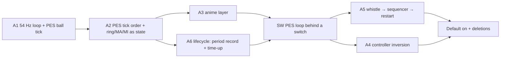

# 15-10-26: plan, Track A (PES-native match loop) and Track B (Fox-faithful rendering)

This is a plan only. Nothing here has started except the work listed under "Running now". The previous day's state
is in `tasks/14-10-26.md` §Close-out. The structure ids (T-*, P-*, MB-*, W-*, K-*, A-*, J-*), wave numbers, gate ids
and gap ids (C*, G-*) are from `docs/re/pes-re-foundation.md`. Gap reports referenced:
- `pes-re-gaps-Anime.md`: GapsAnime, rounds 1-2 done, round 3 running.
- `pes-re-gaps-GapsMatch.md`: GapsMatch, running.

Both reports are in the local session store and get archived to `docs/re/` when they finish.

Owner rulings in force:
- PES is king.
- The live ball runs on PES's 1/54 s tick.
- At most 3 implementation agents run at once. The owner sanctioned five for the current round.
- Exhibition matches only. UI, SQLite and the Godot glue stay GF.

## Landed today
- `fecc10e` **possession latch on main** (`FUN_1404fe9c0` into the human/ball dodge gates). ShootoutCrash: full gate 768/768 on the merge, seed-7 `38dc29d6142683f7`; the earlier shootout segfault did not reproduce (2 single runs, Release + RelWithDebInfo under gdb, ASAN clean, full gate). Latent hazards, not fixed: `Player::GetClosestOpponentDistance` (`player.cpp:429`) derefs a possibly-null closest player; `MentalImage::GetPlayerImage` `players.at(0)` on an empty list (`mentalimage.cpp:45-60`). Both die with A4's deletions.

- Gap reports archived: `docs/re/pes-re-gaps-match.md` (all five decoded; T-INST writer `FUN_140a426f0`, track rebuilt per tick, F10-F12 dead, tick order) and `docs/re/pes-re-gaps-anime.md` (adjuster chain `FUN_1409f1bb0`→`FUN_141eb5e70`→`FUN_141eb3af0`→vt+0x18; motion lists by kind; PM vtable `0x1426329a8`).

### COM styles verification (ComStylesRE, archived `docs/re/pes-re-com-styles.md`)
Verified against the binary. **Renty corrections:** Intention state 4 needs 100°, not 105°; Long's conditions bypass scoring; Breakthrough's COM bits 1/2/4 override Double Touch/grade 2; MiddleShot's +40 is `add ebx,0x28` at `0x14211B686`. **Refuted:** the roll seed is a RandomInfo+8 snapshot, not a "carrier clock"; GF re-seeds per rethink instead of repeating while the snapshot is unchanged. **GF port bugs (fix before Wave 7):** `breakthroughStatGain`/`crossStatGain` are never assigned in production (only tests set them); Intention is missing (`imageState = 0`); CurveShot is not ported; the dispatcher's 7 is missing and Breakthrough is tried before MiddleShot; Breakthrough reads one stat and takes 0..70.

- Merged: `bbcdc28` the carrier stat gains (`breakthroughStatGain`/`crossStatGain` were never loaded in production — only tests set them), Breakthrough's own ramp span, the dispatcher's 7 and its order (gate 768, smoke identical to main; the two `PesChallengeCounters` segfaults were put down to `-j3` load then; they also reproduce serially — corrected in the closed entry below).
- A1 on branch `BallTick` (`3199211`): the sim's logic frame is PES's 1/54 s, the ball integrates on its tick, and the mental-image ring and possession clock follow it. Gate 801/801, smoke stable at `2ced7539479756f3`. Outstanding: the 8-seed paired table and the ≤0.05 m live track-error measurement.
- Group D on branch `MovestepTurn2` (`d6002a4`): 40 tests, baseline-equivalent failures only.
- Known: the two PesChallengeCounters segfaults (`ReportLine`, `MaskHistogram`) — closed below: a
  stale object in this `build/`, not a source defect, and they reproduce serially too.

## Open defect (closed): a stale object file in `build/`, not the source
`PesChallengeCounters.TheReportLineCarriesBothTeamsOrdered` and `…MaskHistogram…` segfaulted (rc=139) during a shootout, at "Referee::Process: standing the…". That backtrace was right, not bogus inlining: the fault is `PenaltyShootoutController::Start` → `Referee::CancelSetPiece`, and the pixels resolve it:
- `build/src/sim/CMakeFiles/gfsim.dir/onthepitch/penaltyshootoutcontroller.cpp.o` (10-15 04:07) was compiled against the pre-merge `Match`, where `referee` sits at 1872. The PoseVeto merge added `int pesFrame` to `Match::BallEvent`, growing `Match` by 16 bytes and moving `referee` to 1888.
- ninja holds **no dependency record for that one object** (`ninja -t deps …` → `#deps 0 (VALID)`; every other gfsim object has ~1000+), so no header change ever rebuilds it and `ninja` alone leaves it stale.
- The binary therefore held two `Match` layouts. The stale object's inline `GetReferee()` loaded `Match+0x750` — `possessionSideHistory` in the current layout, a `blunted::ValueHistory<float>` — and handed it to `CancelSetPiece`; gdb at the fault has `rdi` pointing at `vtable for blunted::ValueHistory<float>`.
A fresh build of the same source passes `--gtest_filter='*ReportLine*'` (53 s) at -O2, -O3 and RelWithDebInfo, and a fresh ninja build records 1176 deps for that object. Remedy: `rm` the object (or wipe `build/`) and rebuild; no source change.

## Wave 1 review (Main, read-only, at `6b3b148`; no fixes applied)

Hygiene: no `#deps 0` object in `build/` (1,486 dep records); all 33 `GetStat` names exist in `assets/fixtures/teams.sql`.

**HIGH**
1. `src/sim/onthepitch/pescarrier.cpp:648-651` (`PlanRoll`), call sites `elizacontroller.cpp:2011-2012, 2141, 2148`: the image dice are seeded from GF's possession frame count. PES seeds from the RandomInfo+8 snapshot copied into BallPlayer+0x78 member+0x18 (`0x14063A490`; `docs/re/pes-re-com-styles.md` §3), which repeats while unchanged. Unfaithful and **not** a named `ponytail:`; `pescarrier.hpp:412-414` still documents it as "carrierClock", a claim the verification refuted.
2. `src/pes/movestep_turn.cpp:94-112` (`RecordWord`) and every decoder that reads it (`RecordSubFrames`, `RecordByteAt`, `RecordFootPair`, …; e.g. `:486`, `:633`): group D rebuilds the motion record word from the **bit pattern of `MotionStartTime*1000` as a float** and decodes PES bit fields out of it. It is named as a ponytail, but the values it yields are arbitrary, not a stand-in for any PES quantity. Harmless while group D is unreached; becomes live the moment MovestepCore's adapter dispatches into it. The real record lists are now decoded (`docs/re/pes-re-gaps-anime.md`: RotData/FootType/PivothitInfo/SubHitData by kind, loader `FUN_1406aef60`).

**MEDIUM**
3. Two groups model the same missing motion record differently: group B returns PES's no-hit fallback 0 (`movestep_run.cpp`, `HitFirstTicks`…), group D decodes the float-pattern word (item 2). One loader should replace both.
4. A1 leftovers on the 10 ms step: `match.cpp:1131` (`bounceVec * 0.01f`) and `:1280-1281` (`sprintVelocity * 0.01f`) scale per-tick player collision offsets by a 10 ms tick; at 1/54 s the push is ~54% of what the code meant. `pesballtrack.hpp:63` (`predictionSizeMs - 10.0`) keeps the old grid as an unnamed literal.
5. Remaining 3D-heading risks (the z leak's siblings): `elizacontroller.cpp:137-138` normalises `(0 - position)` in 3D; `playercontroller.cpp:661` normalises a blended movement in 3D; the root is `humanoidbase.cpp:1257` (`directionVec = movement.GetNormalized()`, 3D movement) which every `GetDirectionVec()` fallback inherits.
6. `elizacontroller.cpp:2010-2012` converts possession ms to PES frames with `/ 1000.0` literal (should be the named `pes::kMilliPerUnit` used in `pesballtrack.hpp`).

**Fixed by Main (`f96f2ed`):** item 4 (collision pushes on the PES tick; horizon literal named), item 6, item 7, and `elizacontroller.cpp:138` of item 5. Gate 871/871; smoke seed-7 `63286486ec6c84de` (moved: player pushes now scale by 1/54 s). Item 9 retracted: the tests pass synthetic geometry as inputs, which the rules allow. Item 8 left: the `Clamp01`/`WrapDeg` copies differ in NaN and fold-range behaviour, each mirrors its own PES site; merging them is a behaviour change. Agents: DiceSeed (item 1), Heading2D (item 5 root).

**LOW**
7. Dead code reintroduced by the image-port merge: `pescarrier.hpp:521-529` `kGfTicksPerPesTick` / `PesFramesToGfTicks` (no caller; comment describes the pre-A1 10 ms tick).
8. Duplicate helpers: `Clamp01` ×6 (`pesballphysics`, `pescarrier`, `pescontact`, `pesjudge`, `peskickerror`, `pesstamina`), `WrapDeg` ×3, `Wrap360` ×3.
9. Tests carry GF's pitch numbers instead of the FieldInfo table: `pes_ball_physics_test.cpp:561` (`52.5f + 0.06f`), `pes_carrier_test.cpp:167/190/201/232` (`3.7f` where production now reads F2 = 3.66).
10. `pesballtrack.cpp` cites report sections, not the head writer `FUN_14080fa80` (now decoded, `pes-re-gaps-match.md` gap 2).
11. `movestep_turn.cpp` carries 37 `(void)` casts (e.g. `:149`, `:160`, `:510-512`): decoded values computed and dropped; each is either a missing PES use or dead.
12. `tests/movestep_probe_stubs.cpp` remains linked into `pes_movestep_run_test`; due to go with MovestepCore.

Checked and clean: MB-G's FieldInfo test asserts relations, not pinned values; MB-H's rating is a named stand-in with tests that would fail on a sign or operand mutation; CarrierGainFix's install test fails on an unloaded gain; A1 has no leftover interpolation helper.

## Handover (17-10-26, late): read this first; supersedes everything below

**Baseline:** `origin/main` = `19d85ff`. Gate green (2 install skips; `DISABLED_ALooseDeadBallInPlayIsReachedAndPlayed` and the pre-existing disabled tests). 20-min seed-7 smoke: switch off `96ce33d3b51d4199` (108183 ticks), `--pes-loop` `5142ab9e307b3bfb` (full time 114606). 2-min off `a3d5e43a3b7b03af`. Repo is PUBLIC (github.com/zocram4cc/GodotFootball); PII audit clean (noreply identity, no keys/emails/PES assets; 12 old commits mention the work drive's mount path, kept by owner ruling).

**Landed this session (all on main):** A5 restart sequencer (`pessequencer.*`, behind `pes_loop`); A6 period record, time-up gate, post-gate judge, breaks, match-speed rate, stoppage time on the PES clock; A4 carrier walk (rules 1,3,5–11), Dribble chooser, Long/Cross units (Keep is dead in PES); MOVESTEP drives players on the PES path (constants via `MatchSetup`); A1 Y spin pump + contact-mode index; NearestList; lane core `peslane.*` (pure, not wired); style gate `pes::style` + Poacher/Fox run depth; PES goal kick; Hygiene (GDExtension now actually loads; `godot.sh` no longer hides import failures); bug fixes (LateralDamping record, class word 0x1f, three uninitialised-memory bugs).

**Merged since the last handover:** DeadBall (with A3States): req[0x4b]/req[0x35] playback fix, the mirrored bearing (`PesBearingDeg`), MOVESTEP clips replaceable in `SelectAnim` (`IsMovementClip`), and the keeper goal kick (the too-similar requeue gate skipped for PES locomotion). PropAudit rounds 1–2 (corrections propagated into 51 older docs; `docs/ports/pes-doc-propagation.md`).

**Held:** `A5Tail` `6b50897` (local rebuild `A5Tail-e906` on DeadBall, unpushed): throw-in spot F1+0.25, release on reach, kick-off receiver, ball dead at the whistle. The outset (0.25 m) makes the throw-in taker's pass unselectable: `GetBodyBallDistanceAdvantage`'s radius check sees the ball 2.7 m away in the humanoid's own `currentMentalImage` (refreshed from `GetMentalImageOwned(reaction)`), not the match image. Next: read the taker's reaction time, make the test read that snapshot, find why it is stale (candidate: `Ball::SetPosition` skips `UpdateLatestMentalImageBallPredictions`). Spot stays at F1+0.25 (PES wins). `GloveRule-held`: keeper glove g1398 is hollow in the asset itself (`docs/re/pes-re-KeeperGlove.md`); owner to decide on merging.

**Open on the PES path:** the loose dead ball (test disabled; `AI_HasPossession` hands control to GF's on-ball branch; PES first touch `FUN_1404f4be0` helpers undecoded); a MOVESTEP hold ~3 m short on sprint-at-ball commands; min-players abandon rule not located (`docs/re/pes-re-min-players.md`; owner to choose wait / force via `MI+0x1748` / live with it).

**Docs:** decodes in `docs/re/` (index `README.md`), implementation reports in `docs/ports/` (own index), render in `docs/render/`, plans in `docs/plans/`. Archive every report on delivery (skill `gf-orchestrator-orders` §4). Known gap: corrections are not propagated back into older docs (external audit: `transitions.md` chaser+8 m, stamina-subs vs match-management 2.3, supporter-side assignments; 8 items, owner to relay the list). A propagation-audit agent is the planned fix.

**Dead theories this session:** "16 playing styles are inert" (gate has 4 callers, 228 sites; `pes-re-style-census.md`); Keep reachable in PES; the A2 freeze was the post-goal kickoff; MOVESTEP's taker stall was a stomped kick anim (it was playback 0 from an unfilled `req[0x4b]`, then the mirrored bearing, then the requeue gate); the match-load element E is the per-frame style source (refuted by a live write).

**Owner rulings in force:** smoke is a tripwire until A4/A5 land (2-min per branch, 20-min at merge); live writes and pins allowed for the Extra Frontman check (logged, restored); never pin `MI+0x1168/0x116c/0x1574`; endless-match patch is process-wide (1e12 thresholds verified), red cards can still end a match. Extra Frontman: +0.2 m confirmed live as a score on a CB (`docs/re/pes-live-EFPin-scores.md`); whether it flips the winner is open.

**Next, in order:** (1) revive A5Tail on the stale mental image, then merge it; (2) owner's 8 audit items into a PropAudit round 3; (3) A4 units BackSpace/GoalFront/Safety/OneTwo/DirectHighBall on the lane core; (4) the loose-ball first touch (decode `FUN_1404f4be0` helpers); (5) A4 team-tick port in GF's current order; (6) Track B turf colour path (`WithersParameter5` floor, grading LUT; `docs/render/pes-exposure-ExposureMatch.md`); (7) remaining style effects as hosts land; (8) switch on by default and delete GF's PES-less paths. Estimate ~22–30 agent runs. Ghidra leaks decompiler processes under heavy use: kill idle `decompile` children of the Ghidra JVM by PID after decode batches.

## Handover (17-10-26 batch): read this first; supersedes the 16-10-26 section below

**Baseline:** `origin/main` = `a47f5f2` (A2Stall with A2Wiring and StallCap, StallCap's cutover, HitIndex, BallContact). Gate 1051 green. Smoke seed-7 20 min `[determinism] 6d0e1e05fa65998d`, full time at 98 381 ticks, `[restarts] 53 stoppages, longest 23.2 s, bound 32.5 s`, `[idle] 54 episodes`, passes 29-25, accuracy 31%-36%, goals 0-5.

**Closed:** the A2 restart stall (touchline free kick spotted past the touch reach; `docs/re/pes-re-touchline-restart-stall.md`), HitData index (`pes-re-hitdata-index.md`), A1 T1+T3 (`pes-re-ball-contact-port.md`), smoke stall guard (`pes-re-restart-watch.md`). The unbound pitch mask is already decoded as faithful (`pes-re-unbound-texture.md`), so ExposureShot's open item 1 is closed.

**Dead theories:** the A2 stall was the post-goal kickoff with the ball in the net (it was a touchline free kick); latch step 2/3a (not involved); `AnyPlayerDown` adding +2.5 s (not the freeze); a global exposure gain (grass is brighter while lines are darker); the whole-body `wsavecap` back text was markings (it is the boots pack's `Patches` art).

**Running at handover:** IdleEpisodes (classify the 54 idle episodes, fix the largest group), AccuracyBisect (attribute the accuracy jump), TouchReach (read-only decode of touch reach, foul-spot clamp, the 1758-tick goal stoppage), Liftoff (A1 T2), PantsSub (`pants_out_sub` blobs on whole-body players, on `UniformParts` `3e7f32f`).

**Held off main:** `UniformParts` `3e7f32f` (WIP, whole-body uniform parts draw `pants_out_sub` artifacts; decode `docs/re/pes-re-whole-body-uniform.md` on that branch), `BodyMarkings` `46a1075`.

**Smoke policy (owner ruling):** until A4/A5 land the smoke is a tripwire only (crash, hang, determinism, gross breakage). 2-min by default; 20-min only at batch merge. Balance lines and `[idle]` are not targets; GF stand-ins are not tuned to move them. Full balance smokes resume after A4, against live PES.

**Still queued:** the two `-j3` intermittent crashes, the broken live `EDIT00000000`, `godot.sh --import` core dump, `pes_possession_test.cpp` unbuilt, A1 T4, PES's glove-replaces-hand rule, same-shot exposure with matched camera and kits, W-player numbers, review fixes, keeper penalty logic, then A3 → A5/A6 → A4.

## Handover (end of 16-10-26 batch): read this first

**Baseline:** `origin/main` = `6114ef3`. Gate 1039/1039 (2 standing install skips). Smoke seed-7 `[determinism] 7407dc1ab4162b83`, `[balance-passing] passes 36-43 | accuracy 19%-20% | clean 19%-18% | clearances 4-1`. The hash moved from `63286486ec6c84de` with MotionRecords and TSheetPort, which is expected and was not tuned. ClipSwap did not move it, because issued clips drive the pose, not sim positions.

**Merged this batch** (all on `6114ef3`):
- **Track A:** A2Events2 `875dbcf` (event store and detectors, C8 gate `gateOpen`); ComStyleGaps `6420b5a` (Long score, veto and accepts; CurveShot cancel; skill 7); NullHazards `d124f62`; TSheetPort `e40e971` (the FK kicker waterfall `FUN_1404a8ad0`); MotionRecords `3f7554a` (real motion tables, one `MoveHost::Motion()` read, review items 2/3); ClipSwap `2b8d0f4` (the FSM's issued clip drives the pose; GF's speed pick deleted); ShootVerdict `e4f6b3d` (diagnosis plus a `DISABLED_` test only).
- **Track B:** B4Grass `6bd1dc8` (weather-only stadium layers); B5Materials `8fd78e0` (whole-body boots path); B6Stadium `3afb4c1` (home team's stadium); B3Post `f9db807`; B7Effects plus EffectsBinding `4f62f26`; PitchV7 `dd38f95` (VS `v7.zw`, guarded by compile only); SceneExposure `3aab078` (`bg_intensity` 1.0); FpkBounds `87f3cba`.

**HELD, not on main:**
- **`A2Merge-held` `7e6cbac`** is A2Wiring `8ec07ff` plus Main's cutover of the two `elizacontroller.cpp` readers and the deletion of `Match::BallEvent`. It gates green (1045/1045), **but the smoke never finishes.** A 20-minute seed-7 run was killed after 43 minutes; 2 minutes takes 38 s. Restarts stall: the ball rests on the goal line (x = 55.1, `piece 1`), the taker never starts, and `[stalemate] forced` is 2442 in 2 minutes against about 12k in 20 on main. **This is the first item of the next batch.** Bisect between A2Wiring's three commits and the cutover (`7e6cbac`). The likely suspects are the latch's step 2 now reading the store (one tick later, per A2Wiring) and step 3a's flag. Also add a test that fails on this.
- **BodyMarkings `46a1075`:** does not work (renders are pixel-identical with and without markings). The decode says PES attaches markings only to uniform category 0/1 parts, so B5's skip of uniform parts for whole bodies is probably wrong. Decode first.
- **Backups on origin** (unmerged loose work, kept rather than deleted): `backup/ComStyleGaps-rebased` `9f027b8` (plus `gf-close-scratch/ComStyleGaps-uncommitted.patch`, 29 lines, likely the same cutover as `7e6cbac`); `backup/MovestepStep-260a58f` (superseded by main's group C).

**Open defects (next batch, in order):**
1. The A2 restart stall (above).
1b. **Stalled restarts drive smoke wall time, and the stall counter hides it.** The match clock advances only `IsInPlay() && !IsInSetPiece()` (`match.cpp:817`), so a stalled restart freezes game time and the 20-minute smoke runs as long as restarts take. `[stalemate] forced` (`match.cpp:791`) counts every loose-ball tick, not stalemates: 1666 of about 6480 ticks in a 2-minute baseline run. The real episodes are the `idle:` lines: 14 in 2 minutes on the baseline, 13 of them `piece 1` (the post-goal kickoff, ball resting in the net at x = 55.1 while the GF forcer chases it). Fix order: (a) cap the smoke by wall time or sim ticks and exit non-zero on a stall; add a test for the maximum stoppage-to-restart time; write it first in the A2 fix, since it catches `A2Merge-held` in seconds. (b) Report idle episodes and the longest restart delay instead of loose-ball ticks. (c) The root fix is A5: PES's referee and restart sequencing replaces GF's choreography and deletes the forcer.
2. Two intermittent crashes, seen only under a parallel `-j3` gate: `SimMatch.AIManagerSwitchGovernsTactics` (segfault, seen twice) and `godot_match_scene_test` (signal 11, not the old pkill). Both pass solo.
3. The owner's live `EDIT00000000` fails its own SHA-512 on block 2, so every save test skips. The gate's `find … | head -1` picks that file. B5 made a re-hashed copy in its scratch dir.
4. Suspected HitData mis-index: PES indexes `(w0 & 0x1fff) + 0x11`; GF's `Mbinfo` and `pesdodge` use `w0 & 0x1fff`. Confirm with a decompile, then fix.
5. `tools/godot.sh --import` core-dumps on a fresh worktree; its `|| true` hides it.
6. `tests/pes_possession_test.cpp` is built by no CMake target. Wire it in or delete it.

**Next work, in order** (inputs are on main unless named):
- **A1:** T1 same-tick landing plus T3 contact mode 1 (one port); T2 lift after a landing (decode, then port). See `docs/re/pes-re-ball-track-live.md`.
- **A2:** fix and land `A2Merge-held`; producers for kinds 2/3/5/27/28; the listener-vs-MatchSub order; the HUD clock writer.
- **Review fixes:** see §"Code review of the baseline batch" below (test_player mode branch, event-kind enum, the `ShownInWeather` ponytail, pressure-class literals, the double boots parse).
- **Track B:** one same-shot exposure measurement on the baseline (broadcast camera, stadium 29: pitch, shirt and stands boxes against a decoded PES frame), which also verifies PitchV7; the whole-body uniform-parts decode, then markings; the B7 match hook.
- **Keeper penalty logic** (ShootVerdict): decode, then port, then enable `DISABLED_ShootoutVerdictIsThePlannedOutcome`.

**First spawn of the next batch** (3 agents, all on `6114ef3`, no file overlap; StallCap pushes first and A2Stall rebases onto it):
1. **StallCap** (tdd-task-implementer): cap `gfsim_run` by sim ticks and exit non-zero on a stalled restart; add a test for the maximum stoppage-to-restart time; report idle episodes and the longest restart delay instead of `forced` ticks. Oracle: the test fails on `A2Merge-held` within seconds and passes on main.
2. **A2Stall** (tdd-task-implementer): bisect `A2Merge-held` `7e6cbac` (A2Wiring's 3 commits plus Main's cutover), root-cause the post-goal kickoff stall, fix it and land A2. Oracle: StallCap's test is green and the 20-minute smoke finishes.
3. **BallContact** (tdd-task-implementer): A1 T1 (same-tick landing) plus T3 (contact mode 1) in `BuildTrack`/`ball.cpp`. Oracle: the one-step landing error is 0 on recorded samples; the live 1 s median falls from 0.71 m to about 0.35 m.

**Remaining estimate** (agent runs, revives included): Track A about 40–46 (critical path A2 → A3 → A5/A6 → A4 switch; A4 alone 12–15); Track B about 13–18 (each item needs a live PES match). Total about 55–65.

**Brief rules:** `local://brief-rules.md` is the single source; the `gf-orchestrator-orders` skill holds the orchestration checklist. Agents run only the tests their change touches; Main gates once per batch.

**Housekeeping done:** 36 merged, clean worktrees removed. 37 stray logs beside the checkout and 79 of this project's `/tmp` files deleted. **Kept:** every `gf-*-scratch` dir, since archived reports cite their evidence (asm dumps, decoded frames), and every unmerged or dirty worktree: `gf-A2Wiring`, `gf-BodyMarkings`, `gf-ComStyleGaps`, `gf-LivePoke`, `gf-MovestepRun` (48 dirty files, old WIP), `gf-MovestepStep`, `gf-MovestepTurn` (5 dirty), `gf-Wave1MBF`, `gf-Wave1MBF-diag` (9 dirty), `gf-Wave1TSheet`.

**PES frames:** OBS output is double sRGB-encoded. Decode each frame once with `magick IN -colorspace RGB OUT`.

**C8 answered (GapsA2):** the K=9/K=10 gate reads the *byte* `MI+0x11b4` (`FUN_140a17810`, `FUN_140a178d0`), open when `== 0`; the live "0x100" was a dword read over `00 01 00 01`. Byte is 0 in all 467 samples. **Owner ruling (16-10-26): record when the byte is 0**, as PES does (`FUN_140a17810`, `FUN_140a178d0`), with no polarity flip. The writer that closes the gate is unfound. Until it is ported, GF never closes it, which matches every observed sample. C4 is unblocked.
**A2 placement:** MA build (`FUN_140536fc0`) runs inside the team tick, so the A2 wiring puts it there, not before the teams.

**OBS PES frames are double sRGB-encoded (B5, verified):** `obs_frame.ts` output reads +1.0 to +2.2 stops hot. Decode every PES frame once with `magick IN.png -colorspace RGB OUT.png`; the decoded frame matches a compositor capture to 0.001. Godot movie frames are already display-correct. Every PES-derived brightness target computed before 16-10-26 (B3 refs, B4 pitch/line 0.25-0.49) must be recomputed on decoded frames. With decoded frames, the lit scene is still about 4.5 stops darker than PES (BNT shirt 0.020 vs 0.468 linear), while the materials check out, so the gap belongs to the B2/B3 rig.

## Code review of the baseline batch (Main, read-only, on `36108d0..HEAD`; no fixes applied)

**HIGH**
1. `godot/tests/test_player.gd` (B5): the test decides which checks to run from what the build produced: whole-body checks `if look_uniforms == 0 and look_parts.has("boots")`. Every player draws a boots part, so if the uniform build broke for a normal player, the test would take the whole-body branch and pass. The mode has to come from the input (the boots pack's skeleton, `pes::CarriesBodySkeleton`), not from the output.
2. `src/gdext/pes_character.cpp` (B5): whole-body players skip `SelectUniformParts` entirely. BodyMarkings' decode (`FUN_141a8b7b0` → `FUN_141a86310` at `0x141a8bc45`/`0x141a8bd3f`) shows PES attaches markings only to uniform parts of category 0/1, yet PES draws a name and number on W backs. So PES very likely still builds those parts for whole bodies, and the skip may be the wrong rule. Needs a decode before more work on whole bodies.

**MEDIUM**
3. `src/pes/stadium.cpp` `ShownInWeather` (B4): the weather filter is a file-name heuristic (`_rain`/`_snow`) with no PES VA and no `ponytail:`. It fixed st029, but it is a GF rule standing in for PES's. It needs a ponytail that names the fox2/weather site that should replace it.
4. `src/sim/onthepitch/pesevents.cpp` (A2Events2): event kinds are bare integers throughout (`Write(9, …)`, `kind == 7`, `kind >= 1 && kind <= 3`, `0x10`, `0x11`, `30`). They need one named enum of PES's K values, which the rules on magic numbers require. The file has 48 VA cites but 2 ponytails, and detectors with missing inputs take them as caller-supplied fields without naming the stand-in at the call site. A2Wiring has to name those.
5. `elizacontroller.cpp` carrier pressure class (ComStyleGaps moved it; the block predates it): the literals `4.0f`, `2.0f`, `2.3f`, `3.0f` and `1000.0f` have no names. `LongVetoed` hard-codes the Intention values `3`/`4` and the `kLongLevelSteps = 2` compare; they are cited but not read from the exe, unlike the four bonuses beside them.
6. `src/gdext/pes_character.cpp` `PackCarriesBody`: for every player it reads and fmdl-parses the boots pack once to classify it, then `AddPack` reads and parses it again. That is avoidable work, ×22 per scene; parse once and reuse.

**LOW**
7. `godot/shaders/pes_pitch.gdshader`: `ID3_TINT`, `ID3_F0` and `VISIBILITY_THRESHOLD` are uncited, while 77 other lines cite asm. The `V7_*` polynomials are asm immediates, hard-coded (stated). There are 7 `[DEVIATION]` notes and 0 `ponytail:`; the deviations should use the repo's ponytail convention.
8. `src/pes/fpk.cpp`: the clamp is honest about PES being INF; acceptable. `pes_lighting.cpp` `set_bg_intensity(1.0)`: correct and cited.
9. `sim_match_test.cpp` `DISABLED_ShootoutVerdictIsThePlannedOutcome`: a disabled test is tracked debt; keep it listed until the keeper penalty port lands.

**A1 live track check: NOT MET** (`docs/re/pes-re-ball-track-live.md`): 253 samples, median 0.71 m at 1 s, 25/253 within 0.05 m. Flight steps are exact; every error is contact. Port queue, in order: **T1** same-tick landing in `BuildTrack` and `ball.cpp` (verified; median to 0.35 m); **T2** the lift tick after a landing (rule unidentified; dominant after T1; needs a decode); **T3** the live contact table is mode 1 while GF launches mode 2 (a live fact, so the faithful fix is mode 1); **T4** spin blend about 0.015 (no 1 s effect). The track record starts at `B+0xB0`; the quaternion is at `+0xBC` (corrects gaps-match §9.2b and officials-ball §5.3). The sim pairing is seeds 7/8 only, and `ddc67cd` is already post-A1 (Main's brief named the wrong base), so no A1 effect was measured; the A1-only pair is `70d323c` → `6106aa8`.

**Next, in order:**
1. Merge each returning branch: rebase onto main, full gate, smoke (and frames for B1/B2/MovestepCore), then push.
2. Before group D runs live: fix review item 2 (replace the float-pattern `RecordWord` with the real motion record lists from `pes-re-gaps-anime.md`) and item 3 (one loader for groups B and D).
3. Review item 1 (PES image dice seed from RandomInfo+8) and item 4 (10 ms leftovers in `match.cpp`) are small TDD tasks.
4. Then A2's wiring (event ring replaces `Match::BallEvent`), A2 tick order, A6 lifecycle per Track A.

**Agent rules that cost time this session** (put them in every brief): worktree only and path-limited git; `flock gf-sim.lock` (beside the checkout) for every ctest/gfsim_run; no `/tmp`; no python/sed source patching; after struct-layout changes check `ninja -t deps` for `#deps 0`; no agent can message Main back, so the final message is the report; use the `agent` field (`tdd-task-implementer`, `task`, `football-reverse-engineer`, `football-game-reverse-engineer`), max 3 implementation agents unless the owner says otherwise; no name-wide kills: `pkill -f Godot_v4.7.2` SIGTERMs every Godot run, gates included (it ended `godot_match_scene_test` in the -j3 gate at 09:01), so kill your own PIDs only.

## Running now (inputs to this plan)

|Agent|Work|Lands as|
|---|---|---|
|ShootoutCrash|full Release gate on the latch merge `b452cab`. The crash did not reproduce single-threaded or under ASAN|merge of the possession latch (`origin/PoseVeto`)|
|MovestepRun2|MOVESTEP group B: Accelerate, Decelerate, RunLoop and their entries|`refs/heads/MovestepRun2`|
|MovestepTurn2|MOVESTEP group D: run the tests, mutations, gate, push|`refs/heads/MovestepTurn2`|
|GapsAnime|round 3: consumer of the A=P+0x428 adjuster, writer of bit 30, the 0x390 list fill, SubHitData|report|
|GapsMatch|instruction-table writer, ball-track writer, the 41-entry support pipeline, F10-F12, tick order|report|

---

# Track A: PES-native match loop

## Shape

GF today runs a 10 ms tick: referee → ball → mental images → teams (ElizaController and GF AI) → officials → bodies. PES runs a 54 Hz logic frame:
- `FUN_14042b9f0`'s ten-step record switch (event stage step 3, detector loop `FUN_140a0d3f0`);
- the team tick `FUN_1404f6c30` reached through `FUN_140a8eff0` → `FUN_1404334e0`;
- MainEval `FUN_142110d30` per player;
- the anime layer, which turns requests into clips with root motion.

Track A replaces the GF loop with PES's, milestone by milestone, behind a switch. It then deletes the GF paths once the switch is the default.

## Milestones against the foundation waves

|Milestone|Needs first (waves/structures)|Replaces (waves/structures/gates)|
|---|---|---|
|A1|W1 MB-F (branch `Wave1MBF` `faae222`), MB-H (merged)|MB-F F1/F2 stand-ins; the 10 ms integrator; MBF's interpolated read (stair-step floor reads return)|
|A2|A1; W1 MB-G (merged), MB-H|W2 MB-B, W3 MB-A + MB-C, W4 MB-E: these stop being "structures added to GF" and become the loop's real state|
|A3|A2; W1 A-MOV (contract merged; groups B/C/D on branches)|W2 P-KIN, W3 A-CLS; gates D1, L1-L4; `humanoid.cpp` GF query selection for every PES action family|
|A6|A2 (MB-E period block)|GF `MatchProgression`, the GF match clock, `pes_endless_match.py`'s purpose (the gate becomes a config knob)|
|SW|A1-A3, A6; the possession latch merged|(none, entry point)|
|A5|SW; W8 J-JDG + J-PRE co-land; MB-E|GF `Referee` buffer/PrepareSetPiece/CancelSetPiece choreography; the stalemate forcer|
|A4|SW; W5 (T-POSS, T-LVL, W-CHOOSER), W6 (T-REACT, T-SHAPE, P-IMG, W-GRID), W7 (T-PRESS+W-PRESSX, K-SEL+P-AIM, K-GKP, MB-D, W-SUP, W-TMISC), W8 (W-SEL, W-AIM, K-ERR), plus W1-2 T-SHEET/T-INST/T-CONC|every gate port of waves 5-8: they are ported as units under MainEval and the team tick, not wired into ElizaController|

Consequence: waves 2-4 are absorbed into A2/A3/A6, and waves 5-8 into A4. No more gate-by-gate wiring into GF's controllers once SW lands. Until then, only finish what is in flight.

## A1: 54 Hz loop with the PES ball tick (ruling: the ball tick is PES's)

**Scope:**
- The sim's logic frame becomes 1/54 s. GF's 10 ms fixed step stays only as render interpolation in the Godot glue.
- The live ball integrates on PES's tick (`pesballphysics`, MBF's diagnostic `livepes` mode, made real).
- The ball track (`pesballtrack`, 250 records) is read with floor reads.
- The four 10 ms finite differences become record differences × 54. Sites: `AIfunctions.cpp:872` `AI_GetToBallMovement`, `humanoid.cpp:2144`, `2859-2860`, `3148-3149`.
- `Predict(ms)` direct reads move to the track. Netting runs on the PES tick.
- Every `actualTime_ms`-based timer that PES counts in frames is converted at the call site. The latch already uses `floor(ms·gs/1000)`.

**RE gaps:**
- the ball-track writer (GapsMatch #2; `pes-re-ball-track.md` §8: shift vs rebuild);
- F7's writers for `+0x2798` and `+0x27a0` (gate C4);
- G-BALLFEET `ctx4+0x6C`;
- `contactTicks` advanced per prediction pass (`ball.cpp:210`, MBF §6).

**Runs:** 3-4. One agent for the loop and ball, one for the four finite-difference sites and `Predict` callers (disjoint files), and one follow-up.

**Acceptance:**
- the gate is green;
- the track error at 1 s is ≤ 0.05 m (MBF measured 0.045 m in `livepes`);
- 8 seeds paired against main, reported (not tuned);
- a live-PES comparison of ball-flight samples (LivePoke's chain: sim ball `*(G+0x40)+0x88` vs the GF replay of the same launch) within 0.1 m at 1 s.

## A2: PES tick order; the event ring, MA and the MI phase block as the real state

**Scope:**
- `Match::Process` follows `FUN_14042b9f0`'s ten steps.
- Step 3 is the event stage. The event ring is GF's own store, mirroring E: rings 0/1/4/5 plus the K table, written by the detector loop's ported detectors, and it replaces GF's four-kind `BallEvent`.
- MA is built per tick: the ball cluster MB-B, the ranked tables MB-C, the ball-line point `MA+0x2482c`.
- The MI phase block MB-E: `116c`, `1554`, `1574`, `1558`. The restart gate is `116c == 1` exactly when `1554 == 0`.
- The team tick placement comes from GapsMatch #5.
- The GF mental image is retired at the end of A4, not here: A2 runs it alongside MA for A3/A4's transition.

**RE gaps:**
- GapsMatch #5 (listener vs MatchSub order; where the referee and the MA build `FUN_140536fc0`'s caller sit);
- §5.1: MB-B B1/B4 (NOFUNC stores), B3/B5; MB-C C2/C3; MI E5-E11 writers;
- conflicts C6, C7, C8;
- G-KEY, G-MI, G-SIT.

**Runs:** 6-8, split three ways:
- the tick scheduler and step skeleton (`match.cpp`);
- the event ring and its detectors (new `pesevents.*`);
- MA and MB-E (new `pesanalysis.*`, `pesphase.*`).

**Acceptance:**
- the gate is green;
- an order test that asserts the step sequence by recorded call order;
- a live-PES comparison over ≥ 10 min: the kind histogram of the ring (GapsMatch's sampler is the reference), possession-flip agreement (41/41 exact-state flips, `pes-re-live-teamplayer.md`), and MA's rank table agreeing ≥ 18/22 at the same frame;
- 8 seeds.

## A3: anime layer (MOVESTEP plus every action class)

**Scope:**
- MOVESTEP groups A to D, the dispatcher `FUN_1406ba900` (INIT, the yaw lock after nine states), and the sim adapter (`MoveHost`).
- The locomotion clip set from the MOVESTEP rows.
- Every other action class: the kick dispatcher `FUN_140732e30` phases 0-2, trap and receive, dodge and tackle (already PES clips), header, keeper actions, contact/fall, set-piece takers.
- PES clips with root motion (Animetable/Mbinfo, loaded), hit and cancel frames from HitData/CancelData.
- GF's `SelectAnim` query path is replaced for every family PES drives.
- Viewer: `godot/match/match.gd` poses from speed today. A3 adds the clip pose path through `src/gdext/pes_animation.*` and `pes_locomotion.*`.

**RE gaps (GapsAnime):**
- the group A helpers (`FUN_1406b93a0`, `FUN_1406b6bb0`, the `FUN_1406b0ed0` readers);
- the HitData/CancelData layout and its fill (`FUN_1414b06c0`/`b0850`; the frame is 8-bit, bits 13-20);
- D1/C22: the vtable at `P+0xac0`;
- the owner chain: PM vtable `0x1426329a8`, `P = PM+0x7d8`;
- L4/C21: the consumer of A=`P+0x428` and the bit-30 writer `FUN_14073338c`;
- §5.1 P-KIN (`hu+0x4c`, `PM+0x5d0`, `hu+8`, `PA+1`), C5 velocity units, G-AIACT.

**Runs:** 8-12:
- groups B/C/D: in flight;
- core (dispatcher, group A, adapter): 2;
- clip set and viewer: 2;
- the kick phases: 2;
- other action classes: 2-4;
- fixes: 1-2.

**Acceptance:**
- the gate is green;
- a movement smoke with frames: a player turning, accelerating and stopping, as Godot frames vs OBS PES frames of the same motion family;
- foot plant with no sliding, judged from the frames;
- 8 seeds;
- `[pes-clips]` counts reported for every family.

## A6: match lifecycle through the period record and the time-up gate

**Scope:**
- The period record `MI+0x1168..0x1194` (period, play state, LIMIT, F, ring stamps; decode `FUN_140a3c050`).
- The time-up gate `FUN_14050b9b0`, with its threshold from `.rdata` `0x142647c64/68`.
- The half-time transition in `FUN_140a115a0`. Periods 5/7/8/9 cover extra time, full time and penalties.
- The HUD clock reads the decoded clock.
- An "endless" exhibition option becomes a config knob that raises the thresholds, as the live tool does.

**RE gaps:** the HUD clock source (`pes-re-clock-live.md` §6-8; decode(ring)+F does not track the HUD), E5's per-frame writer, C8.

**Runs:** 3-4.

**Acceptance:**
- the gate is green;
- a full 90-minute match with the half-time and full-time transitions at PES's frame counts;
- the extra-time and penalty path reached in a test. This also covers the shootout crash class.

## SW: PES loop behind a switch

- **Switch:** config bool `pes_loop` (default false), read in `Match`'s constructor. One code path per tick: there is no per-system mixing at run time.
- **Entry criteria:**
  - A1, A2, A3 and A6 are merged;
  - the possession latch is on main;
  - the gate is green with `pes_loop` both off and on;
  - seed-7 runs to the whistle with `pes_loop=true`, deterministically (same hash twice).
- **What moves over first, inside the switch:**
  1. The tick scheduler and the ball.
  2. The event ring, MA and MI as the state every reader uses.
  3. The anime layer executes all player motion.
  4. GF's ElizaController and teamAIcontroller still decide, issuing requests to MOVESTEP and the action classes through an adapter. That adapter is the thing A4 deletes.
- **Deletion list, once `pes_loop` is the default (after A4 and A5):**
  - **Controllers:** `src/sim/onthepitch/player/controller/elizacontroller.{cpp,hpp}` (2,556 lines); the GF paths of `teamAIcontroller.cpp` (2,487 lines; the team tick port stays); `AIsupport/AIfunctions.{cpp,hpp}` (1,520 lines); `AIsupport/mentalimage.{cpp,hpp}`.
  - **Animation:** `humanoid.cpp`'s GF anim query and selection for PES-driven families; `assets/gf_anims` locomotion use.
  - **Ball and match:** the 10 ms ball integrator in `ballphysics`; `Match::BallEvent` (4 kinds).
  - **Referee and stalemate:** the GF `Referee` set-piece choreography and its stalemate forcer.
  - **Lifecycle:** `matchprogression.cpp`.
  - **Data:** `data/playingstyles.*` dribble helpers.
  - **Switch and adapter:** the `pes_loop=false` branch itself, and the SW adapter.

  Each deletion removes its now-dead tests in the same commit.

**Runs:** 2-3 (the switch, the adapter, the dual gate).

## A5: referee whistle → sequencer → restart programme

**Scope:**
- The judge (J-JDG, `FUN_14050ee40`/`50b490`/`50de50`) decides.
- The whistle builds the sequencer program (`FUN_14044eb10` → `FUN_140444d20` → program `[0x18]`).
- The Flow sequencer runs its steps (`FUN_14044dda0`, builder gate `FUN_1404507d0`; read index `Flow+0x8f0`, `pes-re-clock-live.md` §8.4), producing the restart tail (e.g. `3 5 45 10 1d 1f 45 23 16 12 13 17 14 15 d 34 19 1a`).
- It ends in play (program `[0x1c]`, `116c=1`).
- J-PRE covers the presentation scenes, gestures, offside, dive and DOGSO.

**RE gaps:**
- each sequencer step's body: about 30 step ids, of which only 0x18 is decoded;
- the J-JDG/R1 publishers (§5.1);
- G-OFF (the offside flag block);
- the `MI+0x1554/1574/1558` writers (restart kind, sub-state, restart team).

**Runs:** 5-7 (one RE pass on the step bodies, then 4-5 ports).

**Acceptance:**
- the gate is green;
- every restart kind reached in seeds: kick-off, throw, goal kick, corner, free kick, penalty, drop;
- the restart programme sequence matches a live-PES log of `Flow` steps for the same restart kind;
- 8 seeds;
- frames of a corner and a free kick.

## A4: controller inversion

**Scope:**
- PES MainEval `FUN_142110d30` per player (units: Dribble, PassForward, Shoot, Keep, …; `pes-re-carrier-units*.md`) and the team tick `FUN_1404f6c30` become the controller:
  - the possession latch, the counter writer `FUN_140581980`, the run manager `525530`;
  - the press writer, the shape and line builders, the concepts.
- Each wave-5..8 structure lands as state those units read, not as a GF gate.
- Order follows the waves: W5 → W6 → W7 → W8. Per wave, units move one family at a time (carrier, receiver, off-ball, defender, keeper), each family behind its own sub-switch while SW is off-default.

**RE gaps:**
- §5.1 rows for T-INST (GapsMatch #1, C3 settled: MA base), T-CONC, T-PRESS, W-SUP (GapsMatch #3, the 41-entry pipeline), W-TMISC, W-AIM, P-IMG `rec+0xdc`, image-A;
- conflicts C1, C2, C4, C9;
- G-IMGL, G-CORR.

**Runs:** 20-30 (about 1 run per structure plus about 1 per unit family, at three agents).

**Acceptance (per family and at the end):**
- the gate is green;
- 8 seeds;
- a live-PES comparison of family metrics: Chance-run lifetime median 1.58 s (`pes-re-livepoke.md`), run starts per team per match, possession flips, passes per match, press assignments;
- frames of a pressing sequence and a counter.

## Track A estimate

About 47-68 agent runs at 3 concurrent, on the critical path A1 → A2 → A3 → SW → A4/A5 → default.

---

# Track B: Fox-faithful rendering

This is the visual rule (AGENTS.md): every item is accepted only on an **OBS PES frame vs a Godot frame of the same shot**, captured with `~/ghidra-projects/scratch/obs/obs_frame.ts` (source `PES-vk`). The Godot frame is captured with the viewer or the match scene. "Same shot" means the same camera mode, stadium, time and weather preset, and kit.

|#|Item|RE source|Godot surface|Gap to decode|Runs|
|---|---|---|---|---|---|
|B1|Camera framing (broadcast/in-play)|`pes-re-camera-target.md`, `-camera-settings.md`, `-camera-live.md`, `-stadium-camera.md`|`src/gdext/pes_broadcast_camera.*`, `godot/match/match.gd`|numeric confirmation with the ball in the air (camera-target "OPEN"); user slider location `InplayCamera+0xC/+0x10`; mode writer `InplayCamera+8` (one hop)|3|
|B2|Lighting rig (sun, sky, IBL, shadows)|`pes-re-lighting.md` §0-8|`godot/match/match.tscn` environment, `godot/shaders/pes_common.gdshaderinc`|lighting §9 open items|3-4|
|B3|Tonemap and post chain (adaptation, bloom, colour LUT)|`pes-re-lighting.md` Part C (adaptation law and bloom OBS), `pes-re-effects-particles.md` (post chains)|Godot `Environment`/`CompositorEffect` in the match scene|the 33³ LUT encoding (`ColorCor…`, lighting §9 item 7)|3|
|B4|Grass shader (turf, lines, mowing)|`pes-re-pitch-grass.md` (priorities 1-4 closed), `pes-re-markings.md`, `pes-re-marking-pixels.md`|`godot/shaders/pes_pitch.gdshader`, `src/gdext/pes_marking.*`|priority 5: the turf3d grass mesh (partly decoded)|2-3|
|B5|Materials: kits, skin, hair, eyes|`pes-re-shaders.md`, `pes-re-uniform-params.md`, `pes-kit-assembly.md`, `pes-re-face.md`, `pes-re-face-rig.md`|`godot/shaders/pes_uniform/skin/hair/eye/blin/constant*.gdshader`, `src/gdext/pes_model.*`, `pes_texture.*`|uniform `Repetition` file source (uniform-params §1); shaders §8 open items|4-6|
|B6|Crowd and stadium detail|`pes-re-fox2-stadium.md`, `pes-re-stadium-camera.md` (crowd), `pes-re-fox2-format.md`, `pes-re-cloth-nets.md`|`src/gdext/pes_library.*`, stadium scene loading, `godot/shaders/pes_constant*`|the team → stadium mapping (`Team.bin`, stadium-camera §6); which cloth/net path is drawn (cloth-nets §7)|3-4|
|B7|Cheap extras (particles, weather, HUD polish)|`pes-re-effects-particles.md`, `pes-re-hud-ui.md`|Godot particles, `godot/match` HUD|`vfx_class_db.vfxdb` class table (effects §5)|2-3|

**Dependency order:**
- B1 comes first, because every other comparison needs the same shot.
- B2 → B3: the tonemap is judged on lit frames.
- B4 and B5 can each run once B1-B3 give a fixed shot.
- B6 and B7 come last.

**Track B estimate:** about 20-26 runs.

---

# Combined sequence, concurrency (3) and file disjointness

**Disjointness:** Track A owns `src/sim/**`, `src/pes/movestep*`, `src/pes/animetable*`, `src/pes/mbinfo*` and, from A3, `src/gdext/pes_animation.*`, `pes_locomotion.*`, `pes_character.*`, `gf_match.*` and `godot/match/match.gd`. Track B owns `godot/shaders/**`, `godot/match/match.tscn` (environment), `src/gdext/pes_broadcast_camera.*`, `pes_marking.*`, `pes_model.*`, `pes_texture.*`, `pes_mesh.*`, `pes_library.*`, and `src/pes/{ftex,fmdl,fox2,stadium,uniform,camera}*`.

**Shared:** `godot/match/match.gd`. Track B must not touch it while A3's viewer work runs. B1 needs a hook from it (camera target input), so B1 goes before A3's viewer step.

**Ranked sequence (slots = 3):**

1. **Now:** finish the running round (ShootoutCrash → merge the latch; MovestepRun2, MovestepTurn2; GapsAnime, GapsMatch).
2. **Slot plan, round 1:**
   - A1 (ball tick, 2 agents);
   - B1 (camera; disjoint, and needs owner frames).
3. **Round 2:**
   - A2 tick scheduler;
   - A2 event ring;
   - MOVESTEP core (dispatcher, group A, adapter).
4. **Round 3:**
   - A2 MA/MB-E;
   - A3 clip set and viewer;
   - B2 lighting (disjoint).
5. **Round 4:**
   - A3 kick phases;
   - A6 lifecycle;
   - B3 post.
6. **Round 5:**
   - SW (switch and adapter);
   - A3 action classes;
   - B4 grass.
7. **Rounds 6+:**
   - A5 RE pass, then A5 ports;
   - A4 by wave and family;
   - B5, B6, B7 in the third slot whenever A uses two.

**Can run in parallel with Track A (no shared files):**
- B2-B7 at any point;
- B1 before A3's viewer step.

## Blocked on the owner

- **OBS PES frames.** Every Track B acceptance needs PES running with OBS and a chosen shot. A3 and A5 acceptance need them too: the motion family and restart frames.
- **Live-PES comparison runs.** A1, A2, A4 and A5 need a live match for their reference samples. Read-only; the endless-match tool helps.
- **The SW → default flip, and the deletion commits** (the owner signs off on the deletion list).
- **Shot choices for Track B:** stadium, time of day, weather, and the kits to match.
- **Conflicts §5.3 that need an owner call before their milestone:** C2 (`T+0x250`), C4 (`MA+0x2470c`), C9 (`T+0x255` meaning) before A4; C8 before A2.

## Handover addendum 18-10-26 08:40 — A5Tail revived, LaneStruct spawned
- A5Tail agent revived (tdd-task-implementer): red test ARestartPlacesTheBallInTheTakersMentalImage + one-line fix (Ball::SetPosition refreshes latest mental image). Evidence: tri restarts stall 1758; 0.28 m real vs 2.7 m seen; candidate rejects on `bodyBallDistanceAdvantage >= 1.0` with only the OOB `continue` annotated. Root cause candidate: SetPosition writes no prediction, history clear makes GetMentalImageOwned(reaction) return pre-placement image. Report path: local://pes-port-A5Tail.md. Branch: A5Tail (origin 6b50897 + DeadBall-e906 worktree changes, uncommitted).
- LaneStruct agent spawned (football-reverse-engineer, read-only): map lane-struct channels for BackSpace/GoalFront/Safety/OneTwo/DirectHighBall callers + caller enumeration answering LanePort O14. Needed before A4 carrier-unit wiring (handover item 3). Report path: local://pes-re-lane-structs.md.
- Main baseline still d18a060; A5Tail and LaneStruct are unmerged.

## Handover 18-10-26 ~11:05 — A5Tail-2 blocked/archived; A5Repro + A5Merge spawned; PropAudit3+A8 merged

**Main: e0eece6** (docs: archive A5Tail-2 stale-image report). Baseline: gate green 2 install skips, DISABLED_ALooseDeadBallInPlayIsReachedAndPlayed; smoke seed-7 20-min: off `96ce33d3b51d4199` (108183), pes-loop `5142ab9e307b3bfb` (full time 114606); 2-min off `a3d5e43a3b7b03af`.

**Landed since d18a060:** PropAudit3 docs merge (carrier 9-plan order, supporter decode no-flip, stamina-subs model text; `257f581`); auditor A8 positioning-phases doc (`docs/re/pes-re-positioning-phases.md`, verbatim structure, `7b5913c`); LaneStruct read-only census archived as `docs/re/pes-re-lane-structs.md` + README row (O14 closed: DirectHighBall takes the teammate scan, BackSpace/GoalFront/Safety get only the bool, OneTwo via one-touch; 13 direct call sites, 0 indirect; three FUN_ names are interior VAs).

**A5Tail-2 outcome (job done, 1h50m): BLOCKED on reproduction, fix rejected.** Report `local://pes-test-A5Tail2.md` archived to `docs/ports/pes-test-A5Tail2.md` (+README row, PII clean, pushed). Findings: prepared-tick guard passes on base (LONG run bg_13); only pre-prepare dead ticks fail (~2.5 m at tick 11, inside 300 ms reaction window — reaction-lag model, INF). Restart paths use `ResetSituation`, never `SetPosition`; only keeper hold calls it. SetPosition refresh breaks `pes_tick_a1_test` 18/18→17/18 (writes current track into previous-tick snapshot). Mutations A–E each rebuilt+reverted. Branch `origin/A5Tail2` = `4faa303` (test file only vs A5Tail; pushed, ls-remote confirmed). Net: no src change ships; next is reproduce-first, not fix-first.

**Running now:**
- `A5Repro` (tdd-task-implementer): ONE red test reproducing the throw-in stall in-harness (taker in Special clip, pass queued, -1 returned) on fresh worktree gf-A5Repro from origin/main, branch A5Repro, test-only, no fix. Report → local://pes-test-A5Repro.md.
- `A5Merge` (task): review-only verify+merge of the A5Tail stack (red 6ae2f4c + fix ce74a39) onto A5Tail-e906 worktree state, gate-clean tree, run touched binaries + mutation, push to origin/A5Tail2. No main merge, no gate/smoke.
- `LaneStruct`: done; report archived, agent idle. Its O14 census unblocks A4 carrier-unit wiring (next implementer after A5 green).

**Still awaiting owner:** GloveRule-held merge decision; min-players rule (wait / force via MI+0x1748 / live with it); auditor 8 items; `b8a2` pin ruling (EFPin idle after live scores); PropAudit3+A8 done, no further action.

**Next (priority order):** 1) A5Repro red test → fix against it → A5Merge gate → batch gate+smoke by Main → merge A5 stack. 2) A4 units BackSpace/GoalFront/Safety/OneTwo/DirectHighBall wired on LanePort core using LaneStruct channel map. 3) Loose-ball first touch decode (FUN_1404f4be0 helpers). 4) A4 team tick. 5) Track B turf path. 6) Style effects as hosts land. 7) pes_loop default + delete GF paths.
**Machine:** 5 decompile daemons idle (~11:06); /tmp no longer used; PES2021.exe live (PID 2510857); gf-sim.lock respected by agents (Main-only gate/smoke).
